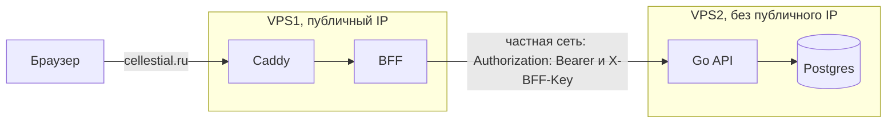

Целевая инфраструктура двух VPS. Перенос Go/Postgres, S2S и следующий этап mTLS
сохраняют проектный статус; наличие схемы не подтверждает выкладку.

<DiagramSection>

## Две VPS

Целевая схема для двух машин. Сейчас стек Pulumi — одна VPS, а двухсерверная схема (gateway и backend)
заморожена в варианте `bff` документации
([`pulumi/README.md`](https://github.com/Cringe-Driven-Development-Team/infra/blob/2f97437/pulumi/README.md#L8)).

<template #diagram>

</template>

- **VPS1:** Caddy и BFF, публичный (floating) IP, домен `cellestial.ru`. **VPS2:** Go API и Postgres, без
  публичного IP, доступна только через частную сеть Selectel.
- **Домен один.** Публичного `api.cellestial.ru` нет: по схеме BFF браузер говорит только с BFF, а
  приложение живёт на одном origin с ним. RFC 10017
  ([§6.1.3.3.2](https://www.rfc-editor.org/rfc/rfc10017#section-6.1.3.3.2)) прямо допускает такую схему:

  > It is also possible to deploy the browser-based application on the same origin as the BFF.

  Отдельный публичный `api.*` нужен только другим клиентам, например мобильному приложению или
  партнёрам, и для них это `Authorization: Bearer` или OAuth, а не cookie.
- **BFF → Go** идёт на приватный адрес VPS2. Файрвол VPS2 (security group) пускает порт API и SSH
  только с VPS1; порт Postgres наружу не открыт вообще.
- **Адрес Go** BFF берёт из переменной `GO_API_URL`: на одной VPS это `http://api:8080/api/v1`, на двух —
  `http://<приватный адрес VPS2>:8080/api/v1`. На VPS2 compose публикует порт API только на приватном
  интерфейсе.

</DiagramSection>

### S2S-ключ

- **Назначение.** На двух VPS BFF передаёт `X-BFF-Key: <BFF_API_KEY>`. Ключ подтверждает знание
  общего секрета сервисами, а Bearer — сессию пользователя.
- **Проверка.** Go проверяет ключ раньше Bearer, сравнивая значение за постоянное время
  (`crypto/subtle.ConstantTimeCompare`; для ключа фиксированной длины этого достаточно).
  Без ключа или с неверным ключом отвечает `403` с кодом `s2s_forbidden`, не `401`.
- **Отказ.** BFF считает `s2s_forbidden` инфраструктурной ошибкой: RPC получает `BAD_GATEWAY`
  (HTTP `502`), HTML — страницу `503`; BFF пишет в лог, refresh не делает и сессию не трогает.
  Иначе попытка refresh с тем же неверным ключом тоже была бы отклонена и привела бы к потере сессии.
- **Хранение.** `BFF_API_KEY` лежит в `.env` обеих машин; в браузер и логи ключ не попадает.
- **Ротация.** На время переключения Go принимает старый и новый ключ. Сначала разрешается новый,
  затем BFF переводится на него; после переключения старый удаляется.

### mTLS — следующий этап

mTLS — TLS с взаимной проверкой сертификатов BFF и Go: шифрует канал и подтверждает идентичность
обеих сторон. `X-BFF-Key` подтверждает знание секрета, но не шифрует HTTP.
Для mTLS нужны выдача сертификатов, настройка доверия и правила ротации; это не входит в MVP.
HTTP внутри частной сети — принятый риск MVP: изоляция сети Selectel ограничивает доступ,
но не является шифрованием. mTLS закрыл бы риск передачи данных открытым текстом.

### Перенос Go и Postgres

[infra#58](https://github.com/Cringe-Driven-Development-Team/infra/issues/58) добавляет BFF в Compose/Caddy
текущей VPS. После проверки этого этапа [infra#59](https://github.com/Cringe-Driven-Development-Team/infra/issues/59)
развёртывает Go и новый PostgreSQL на приватной VPS2 и настраивает доступ к ней. Данные и состояние
миграций со старой VPS не копируются: Go создаёт схему в пустой БД при первом старте. Старые тома
на VPS1 сохраняются. При откате к ним записи, созданные на VPS2 после переключения, автоматически
не попадут. Проверка S2S-ключа и серверный контракт Go —
[backend#41](https://github.com/Cringe-Driven-Development-Team/backend/issues/41),
sub-issue infra#59. PR бэка вливается раньше PR infra#59; переключение на VPS2 выполняется после подготовки обеих сторон.

- **Ansible** ходит на VPS2 по SSH только через VPS1 как jump host (`ProxyJump`): публичного адреса у
  VPS2 нет. Динамический inventory группирует хосты по `metadata.role`
  ([`openstack.yml`](https://github.com/Cringe-Driven-Development-Team/infra/blob/2f97437/ansible/inventory/openstack.yml#L17)),
  так что у второй машины будет своя роль. Файрвол VPS2 должен разрешать API и SSH только с VPS1.
- **Уже есть в Pulumi:** `private-network`, `private-subnet` и `router`
  ([`index.ts`](https://github.com/Cringe-Driven-Development-Team/infra/blob/2f97437/pulumi/index.ts#L181-L201)),
  инстанс `gateway` на порту частной подсети с floating IP
  ([`index.ts`](https://github.com/Cringe-Driven-Development-Team/infra/blob/2f97437/pulumi/index.ts#L250-L280)).
  Ресурсы backend-сервера удалены, и возвращать их под прежним именем нельзя до проверки стейта
  ([`README`](https://github.com/Cringe-Driven-Development-Team/infra/blob/2f97437/pulumi/README.md#L287)).
- **Нужно добавить:** инстанс и порт VPS2 под новым именем, security group и `ProxyJump` в inventory.
  Сейчас sshd запрещает `AllowTcpForwarding`, и в роли отмечено, что jump-хост не нужен
  ([`ssh_hardening`](https://github.com/Cringe-Driven-Development-Team/infra/blob/2f97437/ansible/roles/ssh_hardening/tasks/main.yml#L14-L16)),
  так что для jump host на VPS1 это придётся изменить.

