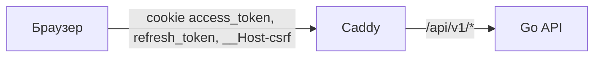
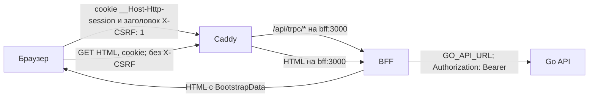

Проект перехода: сравнение исходной схемы с целевой и порядок переключения.
Гостевой HTML и отказы tRPC частично проверены 31.10.2026 — [BFF сейчас](/documentation/bff).
Вход, refresh и операции с данными остаются планом до проверки; канарейка — следующий этап.

## Было и стало

Сейчас токены кладёт в cookie сам Go API, а браузер получает их напрямую:

После переезда между Caddy и Go появляется BFF:

Клиент вызывает процедуры tRPC на `/api/trpc`, данные те же; BFF ходит в Go по `GO_API_URL`
(на одной VPS — `http://api:8080/api/v1`) с `Authorization: Bearer`. До infra PR #71
маршрутизация была такой:
[`Caddyfile.j2`](https://github.com/Cringe-Driven-Development-Team/infra/blob/2f97437/ansible/roles/caddy/templates/Caddyfile.j2#L7)
(`reverse_proxy api:8080`); на одной VPS `api` не публикует порты и виден только из сети `app` — см.
[`compose.yml.j2`](https://github.com/Cringe-Driven-Development-Team/infra/blob/2f97437/ansible/roles/app/templates/compose.yml.j2#L18).

## Cookie до и после

| Cookie | `Path` | `HttpOnly` | `SameSite` | Кто читает |
|---|---|---|---|---|
| `access_token` (сейчас) | `/api/v1` | да | `Lax` | Go API |
| `refresh_token` (сейчас) | `/api/v1/auth` | да | `Lax` | Go API |
| `__Host-csrf` (сейчас) | `/` | **нет** | `Lax` | фронт читает из `document.cookie`, Go сверяет |
| `__Host-Http-session` (после) | `/` | да | `Lax` | только BFF; в браузере JavaScript её не видит |

Подробности про нынешние cookie — в разделе [CSRF](/security/csrf/). `__Host-Http-session` —
`Secure`, без `Domain`, срок `Max-Age` равен `refresh_expires_in`.

## Почему BFF

RFC 10017 «OAuth 2.0 for Browser-Based Applications» (BCP 212) перечисляет архитектуры браузерных
приложений ([§6](https://www.rfc-editor.org/rfc/rfc10017#section-6)) и ставит BFF первой:

> The patterns in this section are presented in decreasing order of security.

Про BFF отдельно
([§6.1.4.3](https://www.rfc-editor.org/rfc/rfc10017#section-6.1.4.3)):

> This architecture is strongly recommended for business applications, sensitive applications, and applications that handle personal data.

У нас личные данные пользователей, так что рекомендация подходит. Практический выигрыш: access и
refresh не доходят до браузера, а значит, XSS на странице не может их украсть. Но XSS всё равно может
слать запросы через BFF от имени пользователя: это сценарий «Proxying Requests via the User's Browser»
в [RFC 10017 §6.1.4.1](https://www.rfc-editor.org/rfc/rfc10017#section-6.1.4.1). BFF убирает кражу
токенов, но не последствия XSS.

## Что меняется

### Фронт

Клиент создаётся в
[`src/api/client.ts`](https://github.com/frontend-park-mail-ru/2026_2_Cringe_Driven_Development/blob/344ad0b/src/api/client.ts#L29)
с `baseUrl: '/api/v1'` и `credentials: 'include'`. Его заменяет официальный `@trpc/client`
(см. [«Клиент»](./contract#клиент)): типы процедур и HTML — `import type { AppRouter, BootstrapData }` из BFF, на каждый
вызов `X-CSRF: 1`, cookie он не читает. Refresh на `401` и повтор после `403` уходят; `UNAUTHORIZED`
означает гостя и форму входа. До первого рендера клиент читает JSON из HTML в свой стор сессии,
без стартового `users.me`; процедура остаётся для явного обновления. Некорректный bootstrap — ошибка
запуска. Задача frontend#34 становится не нужна.

### BFF

Новый сервис на Hono с официальным `@trpc/server` и роутером tRPC на `/api/trpc` (см. [«Роутер»](./contract#роутер)); каркас,
переменные окружения, логи, образ и запуск — [«Сервис BFF»](./service).
`createContext` сначала проверяет `X-CSRF`, `Origin` и `Sec-Fetch-Site`, затем вызывает общий слой
сессии. Его же использует HTML-хендлер; `authedProcedure` требует сессию, а refresh общий для HTML/RPC. Вызовы Go — fetch-клиент от Orval, вход
процедур — zod-схемы от Orval из контракта Go. Работает без своего хранилища сессий. Гонка backend#12
решается внутри BFF, пока он один экземпляр — см. сценарий [«Параллельные RPC»](./auth-scenarios#параллельные-rpc).

### Go API

`Authenticate` сейчас читает access из cookie
[`access_token`](https://github.com/go-park-mail-ru/2026_2_Cringe_Driven_Development/blob/4094350/internal/middleware/authenticate.go#L19),
хотя контракт уже говорит про `Authorization: Bearer`. После переезда он читает `Authorization: Bearer`,
токены отдаются в JSON, а middleware CSRF и CORS, код cookie и переменные `CSRF_SECRET`,
`COOKIE_SECURE`, `CORS_ALLOWED_ORIGINS` удаляются.
Работа на стороне Go — [backend#41](https://github.com/Cringe-Driven-Development-Team/backend/issues/41).

### Infra

В compose добавлен сервис `bff` с `SESSION_KEY` и `APP_ORIGIN`, а Caddy направляет `/api/trpc/*` на
`bff:3000`, как и HTML. Корневой HTML из S3 заменяется шаблоном из образа BFF; ассеты
остаются в CDN. API, public и внутренний `/health` обрабатываются до HTML fallback.
Развёртывание BFF и переключение Caddy подготовлены в
[infra PR #71](https://github.com/Cringe-Driven-Development-Team/infra/pull/71) по
[infra#58](https://github.com/Cringe-Driven-Development-Team/infra/issues/58);
Go и новая БД на VPS2 — [infra#59](https://github.com/Cringe-Driven-Development-Team/infra/issues/59).

## Переключение

MVP использует один экземпляр BFF; короткое окно недоступности при выпуске допустимо.
Порядок переключения:

1. Загрузить ассеты клиента в неизменяемый CDN-каталог своего SHA.
2. Подготовить образ BFF с HTML того же SHA после обеих сборок. Упаковка выполняется вне
   `bff#build`; отдельного promote клиента после playbook нет.
3. После проверки образа и ассетов создать GitHub Deployment для выбранного SHA и вызвать
   `deploy-bff.yml` с digest BFF. Go выкатывается своим playbook; BFF и Caddy переключаются через
   entrypoint BFF. Подробности — на странице [выкатки](./release).
4. Проверить фактически запущенный образ, внутренний `/health`, гостевой HTML, вход и защищённый RPC,
   доступность ассетов своего SHA. Лишь после этого поставить Deployment `success`. Готовность BFF
   предполагает проверенные конфигурацию и шаблон; завершение запросов ограничено конечным сроком —
   подробнее на странице сервиса.
5. [Откат](./rollback) при сбое запускается вручную: он возвращает предыдущий успешный образ
   вместе с HTML и сохранёнными CDN-ассетами. Совместимость Go и миграций БД проверяется отдельно.

Ответы BFF на `auth.login`, `auth.register` и `auth.logout` стирают три старые cookie с их
`Path`: `access_token` (`/api/v1`), `refresh_token` (`/api/v1/auth`) и `__Host-csrf` (`/`). Каждый
пользователь один раз входит заново — см. сценарий
[«Первый вход после переезда»](./auth-scenarios#первыи-вход-после-переезда).
Обычный релиз с прежним `SESSION_KEY` сессию не сбрасывает. Публикацию и выпуск автоматизирует
[frontend#4](https://github.com/Cringe-Driven-Development-Team/frontend/issues/4).

### Канарейка — следующий этап

Сначала новая версия получает небольшой стабильный сегмент пользователей; доля растёт после
проверки ошибок и задержек. При ухудшении нужен возврат трафика на прежнюю версию.
Это отдельное развитие после MVP, со следующими предпосылками:

- HTML и RPC одного пользователя направляются согласованно в выбранную версию.
- Cookie читаются обеими версиями, а refresh безопасен между экземплярами. Текущий in-memory
  single-flight хранит результат 10 секунд в одном BFF и не создаёт общей блокировки между процессами.
- API совместим с открытыми вкладками: совместный образ HTML/BFF не обновляет уже загруженный JavaScript.
- Изменения Go/БД допускают совместную работу версий и безопасный откат.

Один graceful reload Caddy этих условий не обеспечивает. Сегментация трафика и общий механизм refresh
проектируются отдельно; в MVP новые сервисы и распределённые блокировки не добавляются.

