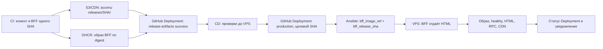

[← Трек BFF](../bff) · [Серверный bootstrap](./bootstrap) · [Откат](./rollback)

# Выкатка BFF

::: info План, ещё не внедрено
Ниже — целевой поток из [frontend#4](https://github.com/Cringe-Driven-Development-Team/frontend/issues/4)
и [infra#74](https://github.com/Cringe-Driven-Development-Team/infra/issues/74). Слитый
[infra PR #71](https://github.com/Cringe-Driven-Development-Team/infra/pull/71) подготовил сервис BFF
и entrypoint с тегом; выпуск по digest и история Deployments ещё предстоят.
:::

## Термины

| Термин | Что означает в этом потоке |
| --- | --- |
| GitHub Deployment | Запись GitHub о выпуске или выкатке: `ref` хранит полный Git SHA, `payload` — ссылки на образ и ассеты, статусы — результат проверки. Это история и указатель на артефакты, а не место их хранения: образ лежит в GHCR, файлы — в S3/CDN. |
| `release-artifacts` Deployment | Успешная запись означает, что CI опубликовал и проверил образ BFF и ассеты одного SHA. Выпуск готов к выкатке, даже если его ещё не запускали на VPS. |
| `production` Deployment | Запись о попытке переключить VPS на выбранный образ и результате проверки. Последний `success` показывает последний подтверждённый результат выкатки, но не доказывает, что контейнер работает сейчас. |
| Полный Git SHA | 40-символьный идентификатор коммита, из которого собраны клиент и BFF. Он помогает выбрать выпуск, но сам по себе не указывает на точный Docker-образ. |
| Digest образа | `sha256:<64 шестнадцатеричных символа>` — хеш манифеста образа в GHCR. Ссылка с `@sha256:…` выбирает точный опубликованный образ; тег `sha-<полный SHA>` нужен для поиска и может быть перезаписан. Digest образа и Git SHA — разные значения. |
| `bff_release_sha` | Вход Ansible: полный Git SHA выбранного выпуска. По нему проверяются метка `org.opencontainers.image.revision` образа, метка в HTML и путь к ассетам `releases/<полный SHA>/`. |
| `bff_image_ref` | Вход Ansible: полная ссылка `ghcr.io/cringe-driven-development-team/bff@sha256:…`. Именно этот публичный образ Ansible скачивает без GHCR-токена и передаёт Compose при выкатке или откате. |

## Один SHA, два артефакта

Один коммит даёт два связанных артефакта. Образ BFF содержит серверный бандл и HTML-шаблон.
В этом HTML ссылки на JS/CSS ведут в неизменяемый каталог `releases/<полный SHA>/` на CDN.
Браузеру HTML отдаёт работающий BFF; загрузка ассетов в CDN сама по себе версию приложения не меняет.

CI получает digest при публикации образа и записывает полный SHA в
`org.opencontainers.image.revision`. После проверки GHCR и CDN он создаёт GitHub Deployment в
окружении `release-artifacts` и ставит ему `success`. У записи `ref` — полный SHA, в `payload` —
`image_ref` по digest, каталог ассетов и ссылка на исходный CI run. Успешные записи прежних выпусков
сохраняются: при создании статуса задаётся `auto_inactive: false`. Повторная сборка того же SHA не
должна молча заменить digest или ассеты; workflow отклоняет конфликт с уже готовым выпуском.
Так можно выбрать и образ, который ещё ни разу не выкатывали. Отдельные Deployments окружения
`production` отражают попытки переключения VPS. В S3 хранится клиентская статика, `release.json` не нужен.

## Путь до production

<Diagram name="modules/2/bff-release" />

На схеме GitHub хранит две истории Deployments: готовые артефакты и попытки выкатки на VPS.
GHCR хранит точный образ, CDN — только ассеты. Работающий BFF отдаёт HTML через Caddy,
браузер загружает JS/CSS с CDN.
Ниже тот же выпуск показан как последовательность шагов.

1. На PR CI проверяет и собирает монорепу без публикации. После проверок `main` он загружает ассеты
   в CDN, публикует публичный образ с HTML того же SHA в GHCR, проверяет анонимное скачивание его
   digest с чистым Docker config и после проверки обоих артефактов создаёт успешный
   `release-artifacts` Deployment. Ошибка любого шага запрещает CD.
2. CD получает выбранный полный SHA, находит единственный успешный `release-artifacts` Deployment
   и до изменения VPS проверяет доступность его digest, совпадение SHA образа и HTML, а также CDN-ассеты.
3. CD создаёт GitHub Deployment в `production`: `ref` равен **SHA выбранного образа**, в `payload`
   лежат `image_ref`, каталог ассетов, действие `deploy` и ссылка на текущий CD run. Для исторического
   SHA используется `auto_merge: false`, чтобы GitHub не пытался объединить его с `main`.
4. Workflow вызывает зафиксированную ревизию `deploy-bff.yml` с `bff_image_ref` и
   `bff_release_sha`. Целевой контракт [infra#74](https://github.com/Cringe-Driven-Development-Team/infra/issues/74)
   скачивает публичный образ по digest без GHCR-токена до изменения Compose, проверяет SHA образа,
   переключает только BFF и подтверждает его `healthy`. Выбранный образ Go сохраняется;
   Caddy ведёт браузер к BFF.
5. Workflow сверяет фактически запущенный образ с выбранным digest, публичный гостевой HTML с одним
   bootstrap `{ user: null }` и меткой SHA, ответ защищённого RPC и доступность JS/CSS своего выпуска.
   Только после этих проверок Deployment получает `success`. Ошибка Telegram-уведомления не отменяет
   подтверждённый результат выкладки.

CI job загрузки ассетов и jobs CD/rollback используют environment `production` для действующих
ограничений и секретов, но отключают его автоматический Deployment через `deployment: false`.
CI явно создаёт запись в `release-artifacts` после публикации **обоих** артефактов; CD и rollback
создают записи в `production`. Иначе GitHub записал бы «успех production» уже при загрузке файлов
в CDN или связал ручной откат с SHA запуска workflow. Успех `production` отражает проверенный VPS.

## Что есть на исходном срезе

На frontend `495981555390f39995bd3ab296b1f6a6e37577c8`
[CI](https://github.com/Cringe-Driven-Development-Team/frontend/blob/495981555390f39995bd3ab296b1f6a6e37577c8/.github/workflows/ci.yml#L35-L66)
загружает ассеты в S3 с `environment: production`, а
[CD](https://github.com/Cringe-Driven-Development-Team/frontend/blob/495981555390f39995bd3ab296b1f6a6e37577c8/.github/workflows/cd.yml#L16-L55)
переключает S3-указатель. На infra `175e37ae77ae3b495ab7dd29c5d41a23e25aec50`
[deploy-bff.yml](https://github.com/Cringe-Driven-Development-Team/infra/blob/175e37ae77ae3b495ab7dd29c5d41a23e25aec50/ansible/deploy-bff.yml#L1-L33)
принимает `bff_image_tag`. Эти ссылки описывают исходное состояние, а не готовый поток выше.
