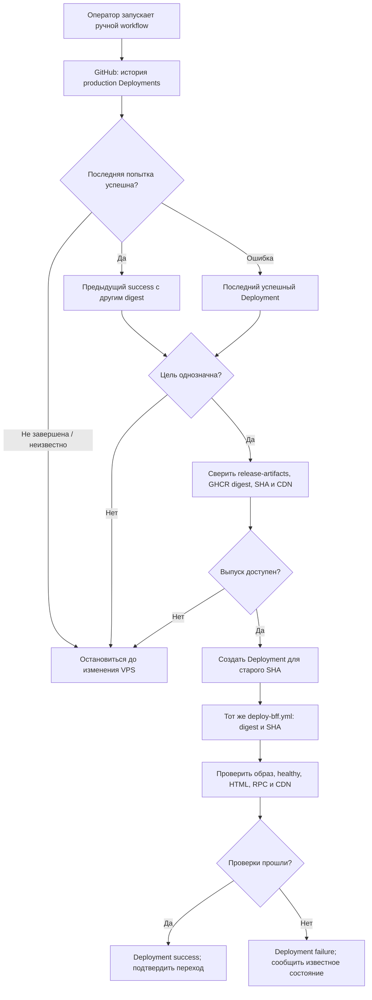

[← Трек BFF](../bff) · [Как проходит выкатка](./release) · [Серверный bootstrap](./bootstrap)

# Ручной откат BFF

::: info План, ещё не внедрено
Это целевой ручной workflow из [frontend#4](https://github.com/Cringe-Driven-Development-Team/frontend/issues/4)
и контракт образа из [infra#74](https://github.com/Cringe-Driven-Development-Team/infra/issues/74).
Сейчас [rollback.yml](https://github.com/Cringe-Driven-Development-Team/frontend/blob/495981555390f39995bd3ab296b1f6a6e37577c8/.github/workflows/rollback.yml#L1-L53)
меняет S3-указатель; он ещё не возвращает образ BFF.
:::

## Как выбрать прежний выпуск

Workflow читает историю `production` Deployments через GitHub API. Каждая успешная запись содержит
полный SHA в `ref` и точный `image_ref` по digest в `payload`. Если последняя попытка закончилась
`success`, цель отката — предыдущий успешный Deployment с **другим** digest. Если последняя попытка
завершилась `failure` или `error`, цель восстановления — последний успешный Deployment. Если попытка
ещё выполняется или её статус неизвестен, workflow не выбирает цель автоматически. Успешный
`release-artifacts` Deployment связывает SHA цели с исходным CI run и CDN-путём.

Для выбора цели отдельное SSH-подключение к VPS не требуется. История показывает **последний
подтверждённый результат выкатки**, но не доказывает, что контейнер работает сейчас: он мог упасть
или быть удалён. Поэтому до нового развёртывания workflow не называет версию на VPS фактической.
Если подходящей успешной записи нет, digest неоднозначен или артефакты недоступны, workflow
останавливается до изменения VPS и показывает причину. Сообщение Telegram и `.env` не служат
источником истории релизов.

## Проверка и переключение

1. В общей с CD и retention группе `production` сверить целевой SHA и digest с успешным
   `release-artifacts` Deployment, проверить доступность digest в GHCR, совпадение
   `org.opencontainers.image.revision` с SHA и сохранность JS/CSS в CDN. Старый тег или S3-указатель
   не заменяют эти проверки.
2. Создать новый GitHub Deployment для **целевого старого SHA**, с действием `rollback`, точным
   `image_ref`, каталогом ассетов и ссылкой на run отката. SHA запуска workflow на `main` не является
   версией BFF. Автоматическую запись от environment job отключить; для старого SHA задать
   `auto_merge: false`.
3. Передать `bff_image_ref` и `bff_release_sha` в тот же `deploy-bff.yml`, что используется при
   обычной выкатке. Ansible скачивает образ до изменения Compose, запускает BFF с его прежним HTML
   и ждёт `healthy`. Go при этом не переключается.
4. После переключения сверить образ контейнера с выбранным digest, метку выпуска и bootstrap в
   публичном HTML, защищённый RPC и доступность ассетов этого SHA. Только тогда новый Deployment
   получает `success`, а уведомление показывает выбранную цель и проверенный результат. При ошибке
   workflow сообщает этап сбоя; фактическую версию после сбоя называет «неизвестно», если она не проверена.

Откат не происходит автоматически. Кнопка «Откатить» в Telegram лишь открывает страницу ручного
workflow. Провал проверки после переключения не превращается в успех из-за того, что команда Ansible
завершилась без ошибки.

## Что остаётся доступным

Retention сохраняет последние пять клиентских выпусков, а сверх них ассеты последнего успешного
production Deployment и предыдущего успешного выпуска с другим digest независимо от возраста.
После неуспешной или незавершённой попытки очистка откладывается до следующего подтверждённого
результата: попытка могла переключить контейнер, даже если проверка не прошла. Иначе старый образ
сможет вернуться, но его HTML будет ссылаться на уже удалённые JS/CSS.

`SESSION_KEY` при обычной выкатке и откате остаётся прежним, поэтому действующая сессионная cookie
читается новым запуском BFF. Откат BFF не откатывает Go API, миграции и данные PostgreSQL;
совместимость выбранного BFF с текущим Go оценивается отдельно.
