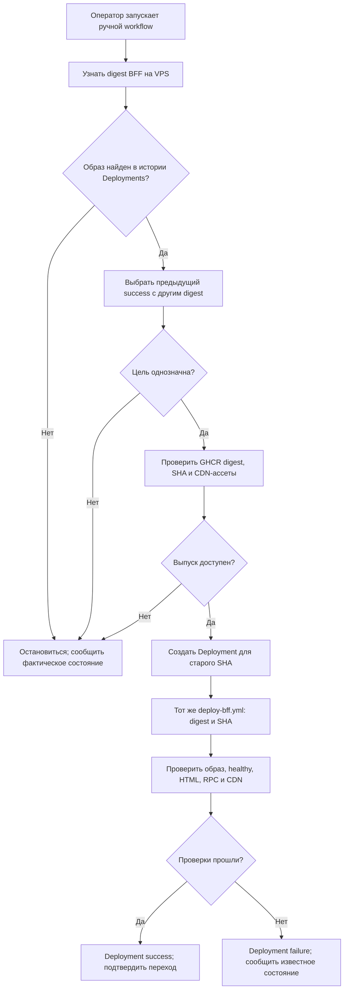

[← Трек BFF](../bff) · [Как проходит выкатка](./release) · [Серверный bootstrap](./bootstrap)

# Ручной откат BFF

::: info План, ещё не внедрено
Это целевой ручной workflow из [frontend#4](https://github.com/Cringe-Driven-Development-Team/frontend/issues/4)
и контракт образа из [infra#74](https://github.com/Cringe-Driven-Development-Team/infra/issues/74).
Сейчас [rollback.yml](https://github.com/Cringe-Driven-Development-Team/frontend/blob/495981555390f39995bd3ab296b1f6a6e37577c8/.github/workflows/rollback.yml#L1-L53)
меняет S3-указатель; он ещё не возвращает образ BFF.
:::

## Как выбрать прежний выпуск

Сначала workflow узнаёт **фактически запущенный** на VPS BFF: сообщение Telegram и последняя запись
GitHub сами по себе этого не доказывают. Затем он находит предыдущий успешный production Deployment
с другим digest. У записи `ref` — полный SHA выбранного BFF, в `payload` — точный `image_ref` и каталог
ассетов. Запись готового выпуска связывает тот же SHA с исходным CI run и CDN-путём.

Если работающий образ не сопоставляется с историей, цель неоднозначна или нет предыдущего успешного
выпуска, workflow останавливается до изменения VPS и сообщает подтверждённое состояние.

## Проверка и переключение

1. В общей с CD и retention группе `production` проверить, что прежний digest доступен в GHCR,
   его `org.opencontainers.image.revision` совпадает с полным SHA, а JS/CSS в каталоге этого SHA
   остаются доступными в CDN. Старый тег или S3-указатель не заменяют эти проверки.
2. Создать новый GitHub Deployment для **целевого старого SHA**, с действием `rollback`, точным
   `image_ref`, каталогом ассетов и ссылкой на run отката. SHA запуска workflow на `main` не является
   версией BFF. Автоматическую запись от environment job отключить; для старого SHA задать
   `auto_merge: false`.
3. Передать `bff_image_ref` и `bff_release_sha` в тот же `deploy-bff.yml`, что используется при
   обычной выкатке. Ansible скачивает образ до изменения Compose, запускает BFF с его прежним HTML
   и ждёт `healthy`. Go при этом не переключается.
4. После переключения сверить образ контейнера с выбранным digest, метку выпуска и bootstrap в
   публичном HTML, защищённый RPC и доступность ассетов этого SHA. Только тогда новый Deployment
   получает `success`, а уведомление показывает подтверждённый переход. При ошибке workflow
   сообщает этап сбоя и известное фактическое состояние; неизвестную версию называет «неизвестно».

Откат не происходит автоматически. Кнопка «Откатить» в Telegram лишь открывает страницу ручного
workflow. Провал проверки после переключения не превращается в успех из-за того, что команда Ansible
завершилась без ошибки.

## Что остаётся доступным

Retention сохраняет последние пять клиентских выпусков, а сверх них ассеты фактически запущенного
BFF и предыдущего успешного Deployment независимо от возраста. Если состояние VPS неизвестно,
потенциально нужные ассеты не удаляются. Иначе старый образ сможет вернуться, но его HTML будет
ссылаться на уже удалённые JS/CSS.

`SESSION_KEY` при обычной выкатке и откате остаётся прежним, поэтому действующая сессионная cookie
читается новым запуском BFF. Откат BFF не откатывает Go API, миграции и данные PostgreSQL;
совместимость выбранного BFF с текущим Go оценивается отдельно.
