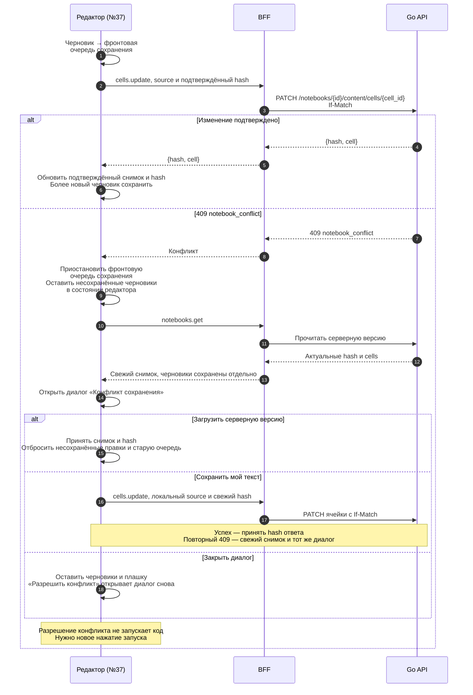
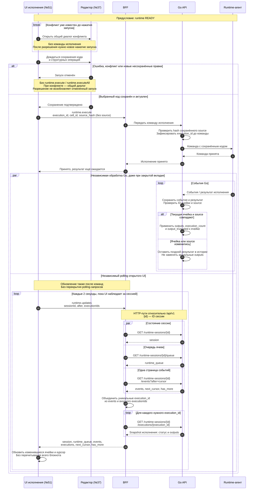

Это целевой интерфейс между редактором, исполнением, BFF и Go во втором модуле.
Вернуться к [общему треку блокнотов](../file-exec) или [редактору](../monaco).
Полные ТЗ: [frontend#37](https://github.com/Cringe-Driven-Development-Team/frontend/issues/37),
[frontend#38](https://github.com/Cringe-Driven-Development-Team/frontend/issues/38),
[frontend#51](https://github.com/Cringe-Driven-Development-Team/frontend/issues/51),
[backend#13](https://github.com/Cringe-Driven-Development-Team/backend/issues/13) и
[backend#14](https://github.com/Cringe-Driven-Development-Team/backend/issues/14).

## Открытие блокнота

При прямом открытии страницы HTML-обработчик вызывает общий серверный загрузчик BFF и передаёт
данные в существующий server bootstrap. Клиент использует подходящий bootstrap без начального
запроса `notebooks.get`. При SPA-переходе без подходящего bootstrap та же tRPC-query вызывает
тот же загрузчик. HTML-обработчик вызывает его напрямую, без HTTP-запроса к собственному tRPC.
Конверт bootstrap с пользовательскими данными сохраняется.

#37 переводит **оба пути** на metadata + content; #51 расширяет **общий результат** полями
`active_session` и `runtime_queue`. #38 добавляет удобства редактора и не меняет этот API.
Метаданные поступают из `GET /notebooks/{id}`, а согласованные `hash` и `cells` — вместе из
`GET /notebooks/{id}/content`; старые `cells` в metadata не используются как содержимое редактора.

В #51 metadata, content и active читаются параллельно. Очередь запрашивается после active только
для сессии текущего блокнота. Если активна сессия другого блокнота, она остаётся в `active_session`,
а `runtime_queue` равна `null`. Для своей сессии пустая очередь — объект с `items: []`; без сессии
оба поля равны `null`. Это не транзакционно атомарный снимок всех чтений. Ошибка любого необходимого
чтения не превращается в успешные пустые данные. `/active` уже содержит сессию: повторный GET session,
журнал и запросы результатов каждой ячейки при открытии не нужны. Открытие не запускает runtime
и не продлевает его активность.

Content содержит сохранённые `outputs`, `execution_count` и `output_truncated` code-ячеек.
Их можно видеть без активного runtime, в том числе после удаления VPS.
Markdown хранится как `id`, `kind: markdown` и исходный `source`.

::: warning Статус целевого контракта на 4 ноября 2026
Таблицы описывают согласованную постановку #37/#51, а не готовность реализации.
Целевая модель: сохранение outputs не меняет hash редактирования. В текущем Apidog и backend#13
ещё описано влияние результатов на ревизию; расхождение требует изменения контракта backend.
Подробнее — [статус хэша](#статус-хэша). Временный режим с двумя семантиками не вводится.
:::

## Фронт → BFF

Все процедуры авторизованы. Мутации проходят существующую защиту BFF от CSRF.
Ни Bearer, ни `X-BFF-Key` браузер для Go не формирует. Ниже — полезные нагрузки процедур,
без транспортного JSON-конверта tRPC. Источники — #37/#51; HTTP-схемы сверены с
[Apidog](https://vb78fyael1.apidog.io/) 04.11.2026.

Для целевых runtime-mutations ниже принята плоская форма: `notebookId` у start,
`sessionId` у остальных; поля тела Go сохраняют snake_case. Это конкретизация адаптера #51,
а не утверждение о наличии таких процедур в текущем BFF.
Все значения вымышлены. Строки — отдельные примеры операций, а не последовательный сценарий.
В batch обе code-ячейки содержат точный source `print(1)` без завершающего перевода строки.

<table class="notebook-api-table" tabindex="0" aria-label="Контракт фронта и BFF">
<thead><tr><th scope="col">tRPC-операция</th><th scope="col">Когда вызывается / роль BFF</th><th scope="col">Входные данные</th><th scope="col">Результат</th></tr></thead>
<tbody>
<tr>
<td><code>notebooks.get</code> query</td>
<td>SPA-переход без подходящего bootstrap или явное перечитывание при конфликте. Общий загрузчик: <a href="https://vb78fyael1.apidog.io/43951862e0">metadata</a> + <a href="https://vb78fyael1.apidog.io/45814238e0">content</a> + <a href="https://vb78fyael1.apidog.io/46351384e0">active</a>; затем <a href="https://vb78fyael1.apidog.io/46495243e0">queue</a> своей сессии.</td>
<td><pre v-pre><code>{
  "id": 42
}</code></pre></td>
<td>Общий результат загрузчика; пример без активной сессии. В HTML он используется внутри существующего bootstrap.<pre v-pre><code>{
  "notebook": {
    "id": 42,
    "name": "Пример",
    "created_at": "2026-11-04T10:00:00Z",
    "updated_at": "2026-11-04T10:00:00Z",
    "hash": "h123",
    "cells": [
      {
        "id": "code-1",
        "kind": "code",
        "source": "print(1)",
        "outputs": [],
        "execution_count": null,
        "output_truncated": false
      }
    ]
  },
  "active_session": null,
  "runtime_queue": null
}</code></pre>
Пример с активной сессией этого блокнота и выполняющейся code-ячейкой. Состояние сессии <code>READY</code> означает готовность окружения; состояние конкретного исполнения — <code>RUNNING</code>.
<pre v-pre><code>{
  "notebook": {
    "id": 42,
    "name": "Пример",
    "created_at": "2026-11-04T10:00:00Z",
    "updated_at": "2026-11-04T10:00:00Z",
    "hash": "h123",
    "cells": [
      {
        "id": "code-1",
        "kind": "code",
        "source": "print(1)",
        "outputs": [],
        "execution_count": null,
        "output_truncated": false
      }
    ]
  },
  "active_session": {
    "id": "123e4567-e89b-42d3-a456-426614174000",
    "notebook_id": 42,
    "language": "python",
    "state": "READY",
    "stage": "ready",
    "reason": null,
    "generation": "123e4567-e89b-42d3-a456-426614174003",
    "created_at": "2026-11-04T10:01:00Z",
    "last_activity_at": "2026-11-04T10:02:00Z",
    "public_seq": 7,
    "journal_incomplete": false,
    "cleanup_error": null
  },
  "runtime_queue": {
    "session_id": "123e4567-e89b-42d3-a456-426614174000",
    "items": [
      {
        "execution_id": "123e4567-e89b-42d3-a456-426614174001",
        "cell_id": "code-1",
        "state": "RUNNING"
      }
    ]
  }
}</code></pre></td>
</tr>
<tr>
<td><code>cells.create</code> mutation</td>
<td>Добавление ячейки. index необязателен; без него — в конец. Прокси <a href="https://vb78fyael1.apidog.io/45814239e0">Контракт Go</a>. BFF передаёт hash в HTTP-заголовке запроса If-Match.</td>
<td><pre v-pre><code>{
  "notebookId": 42,
  "hash": "h123",
  "kind": "code",
  "source": "print(1)",
  "index": 0
}</code></pre></td>
<td><pre v-pre><code>{
  "hash": "h456",
  "cell": {
    "id": "code-1",
    "kind": "code",
    "source": "print(1)"
  }
}</code></pre></td>
</tr>
<tr>
<td><code>cells.update</code> mutation</td>
<td>Сохранение исходника. Прокси <a href="https://vb78fyael1.apidog.io/45814240e0">Контракт Go</a>. BFF передаёт hash в HTTP-заголовке запроса If-Match.</td>
<td><pre v-pre><code>{
  "notebookId": 42,
  "hash": "h123",
  "cellId": "code-1",
  "source": "print(1)"
}</code></pre></td>
<td><pre v-pre><code>{
  "hash": "h456",
  "cell": {
    "id": "code-1",
    "kind": "code",
    "source": "print(1)"
  }
}</code></pre></td>
</tr>
<tr>
<td><code>cells.move</code> mutation</td>
<td>Перемещение: итоговый index с нуля. Прокси <a href="https://vb78fyael1.apidog.io/45814242e0">Контракт Go</a>. BFF передаёт hash в HTTP-заголовке запроса If-Match.</td>
<td><pre v-pre><code>{
  "notebookId": 42,
  "hash": "h123",
  "cellId": "code-1",
  "index": 0
}</code></pre></td>
<td><pre v-pre><code>{
  "hash": "h456"
}</code></pre></td>
</tr>
<tr>
<td><code>cells.delete</code> mutation</td>
<td>Удаление ячейки. Прокси <a href="https://vb78fyael1.apidog.io/45814241e0">Контракт Go</a>. BFF передаёт hash в HTTP-заголовке запроса If-Match.</td>
<td><pre v-pre><code>{
  "notebookId": 42,
  "hash": "h123",
  "cellId": "code-1"
}</code></pre></td>
<td><pre v-pre><code>{
  "hash": "h456"
}</code></pre></td>
</tr>
<tr>
<td><code>runtime.start</code> mutation</td>
<td>«Запустить окружение». Прокси <a href="https://vb78fyael1.apidog.io/46351383e0">Контракт Go</a>. Один request_id на намерение; повтор — с тем же телом.</td>
<td><pre v-pre><code>{
  "notebookId": 42,
  "request_id": "start-1",
  "language": "python"
}</code></pre></td>
<td>Команда принята; готовность определяется состоянием сессии. Сокращённый пример; <a href="https://vb78fyael1.apidog.io/46351383e0">полная схема ответа</a>.<pre v-pre><code>{
  "id": "123e4567-e89b-42d3-a456-426614174000",
  "notebook_id": 42,
  "state": "PROVISIONING",
  "stage": "queued"
}</code></pre></td>
</tr>
<tr>
<td><code>runtime.execute</code> mutation</td>
<td>Одна сохранённая code-ячейка. Прокси <a href="https://vb78fyael1.apidog.io/46351386e0">Контракт Go</a>. source не передаётся; source_hash — SHA-256 точного UTF-8 source. timeout_seconds необязателен (1–86400, по умолчанию 300).</td>
<td><pre v-pre><code>{
  "sessionId": "123e4567-e89b-42d3-a456-426614174000",
  "execution_id": "123e4567-e89b-42d3-a456-426614174001",
  "cell_id": "code-1",
  "source_hash": "d287bb7f9d15abdc5b6e98536263815744b6ef21c8f3c839fc434ca70d8efe99"
}</code></pre></td>
<td>Принятое исполнение, ещё не результат кода. Сокращённый пример; <a href="https://vb78fyael1.apidog.io/46351386e0">полная схема ответа</a>.<pre v-pre><code>{
  "execution_id": "123e4567-e89b-42d3-a456-426614174001",
  "session_id": "123e4567-e89b-42d3-a456-426614174000",
  "cell_id": "code-1",
  "state": "QUEUED",
  "outputs": [],
  "execution_count": null,
  "output_truncated": false,
  "projection": "pending"
}</code></pre></td>
</tr>
<tr>
<td><code>runtime.executeAll</code> mutation</td>
<td>«Выполнить всё»: один <a href="https://vb78fyael1.apidog.io/46495292e0">batch</a>, фиксированный полный порядок 1–1000 сохранённых code-ячеек. timeout_seconds — как у execute. BFF не делает цикл единичных запусков.</td>
<td><pre v-pre><code>{
  "sessionId": "123e4567-e89b-42d3-a456-426614174000",
  "request_id": "batch-1",
  "cells": [
    {
      "cell_id": "code-1",
      "source_hash": "d287bb7f9d15abdc5b6e98536263815744b6ef21c8f3c839fc434ca70d8efe99"
    },
    {
      "cell_id": "code-2",
      "source_hash": "d287bb7f9d15abdc5b6e98536263815744b6ef21c8f3c839fc434ca70d8efe99"
    }
  ]
}</code></pre></td>
<td>Сохранить полный список принятых IDs для наблюдения; это не текущая очередь.<pre v-pre><code>{
  "request_id": "batch-1",
  "session_id": "123e4567-e89b-42d3-a456-426614174000",
  "execution_ids": [
    "123e4567-e89b-42d3-a456-426614174001",
    "123e4567-e89b-42d3-a456-426614174002"
  ]
}</code></pre></td>
</tr>
<tr>
<td><code>runtime.stop</code> mutation</td>
<td>«Завершить окружение». Прокси <a href="https://vb78fyael1.apidog.io/46351390e0">Контракт Go</a>. Принятие не означает завершения очистки; слот занят до её окончания.</td>
<td><pre v-pre><code>{
  "sessionId": "123e4567-e89b-42d3-a456-426614174000"
}</code></pre></td>
<td><pre v-pre><code>{
  "accepted": true
}</code></pre></td>
</tr>
<tr>
<td><code>runtime.activity</code> mutation</td>
<td>После реального изменения source, не чаще раза в 30 секунд; в READY/RECONNECTING. Прокси <a href="https://vb78fyael1.apidog.io/46351389e0">Контракт Go</a>. Polling и preview не считаются активностью.</td>
<td><pre v-pre><code>{
  "sessionId": "123e4567-e89b-42d3-a456-426614174000"
}</code></pre></td>
<td><pre v-pre><code>{
  "accepted": true
}</code></pre></td>
</tr>
<tr>
<td><code>runtime.updates</code> query</td>
<td>Наблюдение каждые 2 секунды и после команд: параллельно <a href="https://vb78fyael1.apidog.io/46351385e0">session</a>, <a href="https://vb78fyael1.apidog.io/46495243e0">queue</a>, <a href="https://vb78fyael1.apidog.io/46351388e0">одна страница events</a>; затем <a href="https://vb78fyael1.apidog.io/46351387e0">snapshots executions</a> по объединению уникальных IDs из событий и executionIds.</td>
<td><pre v-pre><code>{
  "sessionId": "123e4567-e89b-42d3-a456-426614174000",
  "after": 0,
  "executionIds": [
    "123e4567-e89b-42d3-a456-426614174001"
  ]
}</code></pre>after — неотрицательный safe integer, по умолчанию 0. executionIds — до 100 строк длиной 1–128, по умолчанию [].</td>
<td>Сокращённый пример: session и executions показаны частично; их полные схемы — по ссылкам слева. Пустой журнал не отменяет явно запрошенный snapshot.<pre v-pre><code>{
  "session": {
    "id": "123e4567-e89b-42d3-a456-426614174000",
    "notebook_id": 42,
    "state": "READY",
    "stage": "ready"
  },
  "runtime_queue": {
    "session_id": "123e4567-e89b-42d3-a456-426614174000",
    "items": [
      {
        "execution_id": "123e4567-e89b-42d3-a456-426614174001",
        "cell_id": "code-1",
        "state": "QUEUED"
      }
    ]
  },
  "events": [],
  "next_cursor": 0,
  "has_more": false,
  "executions": [
    {
      "execution_id": "123e4567-e89b-42d3-a456-426614174001",
      "session_id": "123e4567-e89b-42d3-a456-426614174000",
      "cell_id": "code-1",
      "state": "QUEUED",
      "outputs": [],
      "execution_count": null,
      "output_truncated": false,
      "projection": "pending"
    }
  ]
}</code></pre></td>
</tr>
</tbody>
</table>

`runtime.updates` передаёт `next_cursor` и `has_more` из Go без пересчёта по числу событий.
Курсор продвигается после успешной обработки всего ответа. При `has_more` страницы дочитываются
последовательно; дополнительные порции `executionIds` тоже последовательно, без параллельных polling-циклов.
Каждый уникальный `body.execution_id` читается один раз за вызов; события инспекции с `inspection_id`
не превращаются в запросы исполнения. Внутренние GET session/queue/events/execution не становятся
отдельными публичными tRPC-процедурами. Агрегат не обещает общей транзакции всех снимков.

## BFF → backend

Все пути относительно `/api/v1`. BFF передаёт Bearer пользователя и обязательный серверный
`X-BFF-Key`; Go проверяет владельца блокнота/сессии. Эти значения не входят в примеры и не отдаются
браузеру. Общие механизмы авторизации и защиты запросов сохраняются.

В path примеров `id = 42` для блокнота, `id = 123e4567-e89b-42d3-a456-426614174000`
для сессии, `cell_id = code-1`, `execution_id = 123e4567-e89b-42d3-a456-426614174001`.
ID блокнота — положительное целое, сессии — UUID, cell_id — 1–64 символа `a-zA-Z0-9_-`,
execution_id — строка 1–128 символов. JSON ниже содержит только тело, path и query указаны отдельно.
В CRUD `notebookId`, `cellId` и `hash` из tRPC не копируются в JSON Go.

**Как связаны hash, ETag и If-Match.** `hash` — поле JSON с версией блокнота.
`ETag` — HTTP-заголовок **ответа Go**: в нашем контракте он содержит тот же hash в двойных кавычках,
например `ETag: "h123"`. `If-Match` — HTTP-заголовок **запроса BFF к Go** с ожидаемой версией:
`If-Match: "h123"` означает «примени изменение, только если версия всё ещё h123».
Назначение этих HTTP-заголовков описано в [RFC 9110](https://www.rfc-editor.org/rfc/rfc9110.html#section-13.1.1).

Например, фронт получил `hash: "h123"` и передал его в `cells.update`. BFF поместил эту версию
в заголовок `If-Match: "h123"`. Go сравнивает её с текущей версией атомарно с изменением:
при совпадении сохраняет правку, при несовпадении по нашему API возвращает `409 notebook_conflict`
и не применяет её. Ответ успешного изменения содержит подтверждённый hash в JSON и в заголовке ETag;
следующая мутация использует эту версию.

Термин «сильный ETag» обозначает метку без префикса `W/`, сравниваемую точно.
Наш API принимает в If-Match только одну такую метку; списки, `*`, `W/` и пустое значение запрещены.
Фронт передаёт обычное поле `hash` в tRPC — HTTP-заголовки для Go формирует BFF.

Строки сгруппированы по tRPC-ручкам BFF. Внутри каждой группы указаны вызываемые HTTP-ручки бэка.

<table class="notebook-api-table" tabindex="0" aria-label="Контракт BFF и backend">
<thead><tr><th scope="col">HTTP-операция backend</th><th scope="col">Назначение / условие вызова</th><th scope="col">Параметры, заголовки и тело</th><th scope="col">HTTP-статус и результат</th></tr></thead>
<tbody>
<tr><th colspan="4" scope="rowgroup"><code>notebooks.get</code> Общий загрузчик также используется в server bootstrap; после bootstrap повторного запроса из браузера нет.</th></tr>
<tr>
<td><a href="https://vb78fyael1.apidog.io/43951862e0"><code>GET /notebooks/{id}</code></a></td>
<td>Метаданные; cells этого ответа не заменяют content.</td>
<td>Path: id блокнота. Без тела.</td>
<td>200 OK. Сокращённый пример; <a href="https://vb78fyael1.apidog.io/43951862e0">полная схема ответа</a>.<pre v-pre><code>{
  "id": 42,
  "name": "Пример",
  "created_at": "2026-11-04T10:00:00Z",
  "updated_at": "2026-11-04T10:00:00Z"
}</code></pre></td>
</tr>
<tr>
<td><a href="https://vb78fyael1.apidog.io/45814238e0"><code>GET /notebooks/{id}/content</code></a></td>
<td>Согласованные hash и cells из одного ответа.</td>
<td>Path: id блокнота. Без тела.</td>
<td>200 OK; HTTP-заголовок ответа <code>ETag: "h123"</code> содержит тот же hash, что и тело JSON.<pre v-pre><code>{
  "hash": "h123",
  "cells": [
    {
      "id": "code-1",
      "kind": "code",
      "source": "print(1)",
      "outputs": [],
      "execution_count": null,
      "output_truncated": false
    }
  ]
}</code></pre></td>
</tr>
<tr>
<td><a href="https://vb78fyael1.apidog.io/46351384e0"><code>GET /runtime-sessions/active</code></a></td>
<td>Активная сессия пользователя. Ответ уже содержит полную сессию; не дублировать GET session.</td>
<td>Без path/query/body. Единственная активная сессия пользователя.</td>
<td>200 OK. Пример без сессии; иначе active_session содержит RuntimeSession.<pre v-pre><code>{
  "active_session": null
}</code></pre></td>
</tr>
<tr>
<td><a href="https://vb78fyael1.apidog.io/46495243e0"><code>GET /runtime-sessions/{id}/queue</code></a></td>
<td>Очередь: только если активная сессия относится к открываемому блокноту.</td>
<td>Path: id сессии. Без тела.</td>
<td>200 OK. Только исполнения code-ячеек QUEUED/RUNNING, без инспекций; пустая очередь — items: [].<pre v-pre><code>{
  "session_id": "123e4567-e89b-42d3-a456-426614174000",
  "items": [
    {
      "execution_id": "123e4567-e89b-42d3-a456-426614174001",
      "cell_id": "code-1",
      "state": "QUEUED"
    }
  ]
}</code></pre></td>
</tr>
</tbody>
<tbody>
<tr><th colspan="4" scope="rowgroup"><code>cells.create</code></th></tr>
<tr>
<td><a href="https://vb78fyael1.apidog.io/45814239e0"><code>POST /notebooks/{id}/content/cells</code></a></td>
<td>Добавление ячейки.</td>
<td>Path: id блокнота. HTTP-заголовок запроса: <code>If-Match: "h123"</code> — сохранить только при текущем hash=h123. По нашему контракту допустим один hash в двойных кавычках; список, *, префикс W/ и пустое значение отклоняются. index необязателен (0–1000), по умолчанию в конец; kind: code или markdown.<pre v-pre><code>{
  "kind": "code",
  "source": "print(1)",
  "index": 0
}</code></pre></td>
<td>201 Created; HTTP-заголовок ответа <code>ETag: "h456"</code> содержит подтверждённый hash из тела JSON.<pre v-pre><code>{
  "hash": "h456",
  "cell": {
    "id": "code-1",
    "kind": "code",
    "source": "print(1)"
  }
}</code></pre></td>
</tr>
</tbody>
<tbody>
<tr><th colspan="4" scope="rowgroup"><code>cells.update</code></th></tr>
<tr>
<td><a href="https://vb78fyael1.apidog.io/45814240e0"><code>PATCH /notebooks/{id}/content/cells/{cell_id}</code></a></td>
<td>Изменение source ячейки.</td>
<td>Path: id блокнота, cell_id. HTTP-заголовок запроса: <code>If-Match: "h123"</code> — сохранить только при текущем hash=h123. По нашему контракту допустим один hash в двойных кавычках; список, *, префикс W/ и пустое значение отклоняются. Меняет source выбранной ячейки.<pre v-pre><code>{
  "source": "print(1)"
}</code></pre></td>
<td>200 OK; HTTP-заголовок ответа <code>ETag: "h456"</code> содержит подтверждённый hash из тела JSON.<pre v-pre><code>{
  "hash": "h456",
  "cell": {
    "id": "code-1",
    "kind": "code",
    "source": "print(1)"
  }
}</code></pre></td>
</tr>
</tbody>
<tbody>
<tr><th colspan="4" scope="rowgroup"><code>cells.delete</code></th></tr>
<tr>
<td><a href="https://vb78fyael1.apidog.io/45814241e0"><code>DELETE /notebooks/{id}/content/cells/{cell_id}</code></a></td>
<td>Удаление ячейки.</td>
<td>Path: id блокнота, cell_id. HTTP-заголовок запроса: <code>If-Match: "h123"</code> — сохранить только при текущем hash=h123. По нашему контракту допустим один hash в двойных кавычках; список, *, префикс W/ и пустое значение отклоняются. Без тела.</td>
<td>200 OK; HTTP-заголовок ответа <code>ETag: "h456"</code> содержит подтверждённый hash из тела JSON.<pre v-pre><code>{
  "hash": "h456"
}</code></pre></td>
</tr>
</tbody>
<tbody>
<tr><th colspan="4" scope="rowgroup"><code>cells.move</code></th></tr>
<tr>
<td><a href="https://vb78fyael1.apidog.io/45814242e0"><code>POST /notebooks/{id}/content/cells/{cell_id}/move</code></a></td>
<td>Перемещение ячейки.</td>
<td>Path: id блокнота, cell_id. HTTP-заголовок запроса: <code>If-Match: "h123"</code> — сохранить только при текущем hash=h123. По нашему контракту допустим один hash в двойных кавычках; список, *, префикс W/ и пустое значение отклоняются. index 0–999 — итоговая позиция.<pre v-pre><code>{
  "index": 0
}</code></pre></td>
<td>200 OK; HTTP-заголовок ответа <code>ETag: "h456"</code> содержит подтверждённый hash из тела JSON.<pre v-pre><code>{
  "hash": "h456"
}</code></pre></td>
</tr>
</tbody>
<tbody>
<tr><th colspan="4" scope="rowgroup"><code>runtime.start</code></th></tr>
<tr>
<td><a href="https://vb78fyael1.apidog.io/46351383e0"><code>POST /notebooks/{id}/runtime-sessions</code></a></td>
<td>Запуск окружения.</td>
<td>Path: id блокнота. request_id 1–128 символов; language python или r, UI модуля использует python.<pre v-pre><code>{
  "request_id": "start-1",
  "language": "python"
}</code></pre></td>
<td>202 Accepted. Сокращённый пример; <a href="https://vb78fyael1.apidog.io/46351383e0">полная схема ответа</a>.<pre v-pre><code>{
  "id": "123e4567-e89b-42d3-a456-426614174000",
  "notebook_id": 42,
  "state": "PROVISIONING",
  "stage": "queued"
}</code></pre></td>
</tr>
</tbody>
<tbody>
<tr><th colspan="4" scope="rowgroup"><code>runtime.execute</code></th></tr>
<tr>
<td><a href="https://vb78fyael1.apidog.io/46351386e0"><code>POST /runtime-sessions/{id}/executions</code></a></td>
<td>Одиночный запуск.</td>
<td>Path: id сессии. Без source. timeout_seconds необязателен (1–86400, default 300).<pre v-pre><code>{
  "execution_id": "123e4567-e89b-42d3-a456-426614174001",
  "cell_id": "code-1",
  "source_hash": "d287bb7f9d15abdc5b6e98536263815744b6ef21c8f3c839fc434ca70d8efe99"
}</code></pre></td>
<td>202 Accepted. Сокращённый пример; <a href="https://vb78fyael1.apidog.io/46351386e0">полная схема ответа</a>.<pre v-pre><code>{
  "execution_id": "123e4567-e89b-42d3-a456-426614174001",
  "session_id": "123e4567-e89b-42d3-a456-426614174000",
  "cell_id": "code-1",
  "state": "QUEUED",
  "outputs": [],
  "execution_count": null,
  "output_truncated": false,
  "projection": "pending"
}</code></pre></td>
</tr>
</tbody>
<tbody>
<tr><th colspan="4" scope="rowgroup"><code>runtime.executeAll</code></th></tr>
<tr>
<td><a href="https://vb78fyael1.apidog.io/46495292e0"><code>POST /runtime-sessions/{id}/executions/batch</code></a></td>
<td>Один массовый запрос.</td>
<td>Path: id сессии. request_id 1–128; 1–1000 ячеек, порядок зафиксирован. timeout_seconds необязателен, как у одиночного исполнения.<pre v-pre><code>{
  "request_id": "batch-1",
  "cells": [
    {
      "cell_id": "code-1",
      "source_hash": "d287bb7f9d15abdc5b6e98536263815744b6ef21c8f3c839fc434ca70d8efe99"
    },
    {
      "cell_id": "code-2",
      "source_hash": "d287bb7f9d15abdc5b6e98536263815744b6ef21c8f3c839fc434ca70d8efe99"
    }
  ]
}</code></pre></td>
<td>202 Accepted. Приём атомарен. Повтор с тем же request_id и телом возвращает полный исходный список; другое тело — 409.<pre v-pre><code>{
  "request_id": "batch-1",
  "session_id": "123e4567-e89b-42d3-a456-426614174000",
  "execution_ids": [
    "123e4567-e89b-42d3-a456-426614174001",
    "123e4567-e89b-42d3-a456-426614174002"
  ]
}</code></pre></td>
</tr>
</tbody>
<tbody>
<tr><th colspan="4" scope="rowgroup"><code>runtime.stop</code></th></tr>
<tr>
<td><a href="https://vb78fyael1.apidog.io/46351390e0"><code>POST /runtime-sessions/{id}/stop</code></a></td>
<td>Завершение окружения.</td>
<td>Path: id сессии. Без тела.</td>
<td>202 Accepted. Очистка асинхронна; её завершение видно по session.<pre v-pre><code>{
  "accepted": true
}</code></pre></td>
</tr>
</tbody>
<tbody>
<tr><th colspan="4" scope="rowgroup"><code>runtime.activity</code></th></tr>
<tr>
<td><a href="https://vb78fyael1.apidog.io/46351389e0"><code>POST /runtime-sessions/{id}/activity</code></a></td>
<td>Сигнал реального редактирования.</td>
<td>Path: id сессии. Без тела. Реальное редактирование в READY/RECONNECTING.</td>
<td>200 OK.<pre v-pre><code>{
  "accepted": true
}</code></pre></td>
</tr>
</tbody>
<tbody>
<tr><th colspan="4" scope="rowgroup"><code>runtime.updates</code> Один вызов tRPC каждые 2 секунды и после команд: session, queue и одна страница events читаются параллельно; затем — snapshots нужных исполнений.</th></tr>
<tr>
<td><a href="https://vb78fyael1.apidog.io/46351385e0"><code>GET /runtime-sessions/{id}</code></a></td>
<td>Состояние сессии; параллельно с queue и events.</td>
<td>Path: id сессии. Без тела.</td>
<td>200 OK. Сокращённый пример; <a href="https://vb78fyael1.apidog.io/46351385e0">полная схема ответа</a>.<pre v-pre><code>{
  "id": "123e4567-e89b-42d3-a456-426614174000",
  "notebook_id": 42,
  "state": "READY",
  "stage": "ready"
}</code></pre></td>
</tr>
<tr>
<td><a href="https://vb78fyael1.apidog.io/46495243e0"><code>GET /runtime-sessions/{id}/queue</code></a></td>
<td>Очередь исполнения ячеек; параллельно с session и events.</td>
<td>Path: id сессии. Без тела.</td>
<td>200 OK. Только исполнения code-ячеек QUEUED/RUNNING, без инспекций; пустая очередь — items: [].<pre v-pre><code>{
  "session_id": "123e4567-e89b-42d3-a456-426614174000",
  "items": [
    {
      "execution_id": "123e4567-e89b-42d3-a456-426614174001",
      "cell_id": "code-1",
      "state": "QUEUED"
    }
  ]
}</code></pre></td>
</tr>
<tr>
<td><a href="https://vb78fyael1.apidog.io/46351388e0"><code>GET /runtime-sessions/{id}/events</code></a></td>
<td>Одна страница событий за вызов; параллельно с session и queue.</td>
<td>Path: id сессии. Query: <code>after=0</code>, необязательный неотрицательный int64 (default 0); BFF ограничивает safe integer. Без тела.</td>
<td>200 OK. До 100 событий; целевой лимит страницы 16 MiB, первое крупное событие не отбрасывается. next_cursor задаёт Go.<pre v-pre><code>{
  "events": [],
  "next_cursor": 0,
  "has_more": false
}</code></pre></td>
</tr>
<tr>
<td><a href="https://vb78fyael1.apidog.io/46351387e0"><code>GET /runtime-sessions/{id}/executions/{execution_id}</code></a></td>
<td>После events: по одному запросу на уникальный execution_id из событий и входного executionIds. Не все ячейки.</td>
<td>Path: id сессии, execution_id. Без тела.</td>
<td>200 OK. Текущий snapshot, в том числе незавершённый. Сокращённый пример; <a href="https://vb78fyael1.apidog.io/46351387e0">полная схема ответа</a>.<pre v-pre><code>{
  "execution_id": "123e4567-e89b-42d3-a456-426614174001",
  "session_id": "123e4567-e89b-42d3-a456-426614174000",
  "cell_id": "code-1",
  "state": "QUEUED",
  "outputs": [],
  "execution_count": null,
  "output_truncated": false,
  "projection": "pending"
}</code></pre></td>
</tr>
</tbody>
</table>

## Ошибки

Ниже разделены текущая общая обработка BFF и требования #51. В текущем
[преобразовании GoError](https://github.com/Cringe-Driven-Development-Team/frontend/blob/8ff2f6c67e06a293fe70aec2af4430c817496ee4/apps/bff/src/errors.ts)
HTTP 400/401/403/404/409 переводятся в tRPC BAD_REQUEST/UNAUTHORIZED/FORBIDDEN/NOT_FOUND/CONFLICT.
Прикладной `code` сохраняется в `error.data.appCode`, категория tRPC — в `error.data.code`.
Остальные статусы, сетевые ошибки и таймауты дают BAD_GATEWAY; исключение — `s2s_forbidden`,
который тоже даёт BAD_GATEWAY при HTTP 403. Реакция UI определяется кодами, не текстом message.

| Условие | Ошибка Go | BFF | Реакция UI |
| --- | --- | --- | --- |
| Нет авторизации / нет доступа к ресурсу | 401 unauthorized / 404 not_found | UNAUTHORIZED / NOT_FOUND, appCode сохранён | Вход или недоступный ресурс; не создавать пустой блокнот |
| Неверный серверный ключ / CSRF | 403 s2s_forbidden / csrf_invalid | BAD_GATEWAY / FORBIDDEN соответственно | Показать сбой / отказ; не требовать от пользователя серверный ключ |
| Неверный ввод | 400 validation_error | BAD_REQUEST + appCode | Исправить ввод; черновик сохранить |
| Достигнут лимит 1000 ячеек | 409 too_many_cells | CONFLICT + appCode | Показать ограничение добавления; существующий текст сохранить |
| Устаревший hash редактирования | 409 notebook_conflict | CONFLICT + appCode | Приостановить фронтовую очередь сохранения, сохранить черновики, получить свежий снимок и открыть диалог выбора версии |
| Уже есть активная сессия | 409 active_session_exists с active_session | CONFLICT + appCode уже извлекается; сохранение публичной active_session в ошибке — требование #51, текущий unwrap сохраняет только code | Показать существующую сессию; не запускать другую автоматически |
| Source/порядок изменились или ID команды повторён с другим телом | 409 conflict | CONFLICT + appCode | Обновить состояние; новое намерение запуска требует действия пользователя |
| Не хватает места в очереди | 429 queue_full | Сейчас BAD_GATEWAY + appCode queue_full, не TOO_MANY_REQUESTS | Показать переполнение; отказ batch не означает частичного запуска |
| Runtime недоступен | 503 runtime_unavailable | BAD_GATEWAY + appCode | Показать недоступность; UNKNOWN не перезапускать автоматически |
| Сбой внутреннего чтения агрегатора / сеть / 5xx | Ошибка соответствующего чтения | Общая ошибка, без подстановки null/пустых массивов вместо обязательных данных | Не продвигать курсор и не стирать последний успешный снимок; дать повторить чтение |

Публичные данные конфликта активной сессии нужно сохранить через общий формат ошибок BFF в #51;
новый несогласованный error envelope здесь не вводится. Ошибки HTML/bootstrap обрабатываются
существующим путём страницы: JSON tRPC-ошибки не вкладываются вместо данных bootstrap.
После неясного исхода записи (сеть/500) перед повтором перечитывается состояние, а локальный текст
сохраняется — подробнее в следующем разделе.

<DiagramSection>

## Сохранение и конфликты

#37 хранит локальный черновик отдельно от подтверждённого source. После 500 мс без ввода отправляется
ожидающая правка; выход из редактора и запрос запуска отправляют её сразу, если сохранение не приостановлено
из-за конфликта. Незавершённую IME-композицию
не сохраняют. Пока запрос выполняется, новый ввод остаётся черновиком: старый ответ его не перезаписывает.

Мутации `cells.create/update/move/delete` проходят последовательно для одного блокнота с последним
подтверждённым хэшем. Фронт передаёт поле `hash` в tRPC, а BFF помещает его в HTTP-заголовок
`If-Match` запроса к Go — например, `If-Match: "h123"`. Это условие «сохранить, только если версия блокнота
всё ещё h123». Тот же hash приходит от Go в JSON и в HTTP-заголовке ответа `ETag`.
Фронт и BFF не вычисляют эту версию сами, а передают полученную от Go строку без изменения;
в JSON запроса к Go hash не помещается. Используются маршруты `/content/cells`
и стабильный `cell_id`; move задаёт итоговую позицию с нуля.
Создание и изменение возвращают `{hash, cell}`, удаление и перемещение — `{hash}`.
Отсутствие outputs в ответе редактирования не стирает результаты других ячеек; перемещение их сохраняет.
Подтверждённое изменение code-source очищает показ прежнего результата, его счётчик и признак усечения.

При `409 notebook_conflict`:

1. #37 приостанавливает фронтовую очередь сохранения. Несохранённые черновики остаются в состоянии
   редактора. Уже запущенная очередь исполнения на бэке продолжает работать.
2. `notebooks.get` получает свежий серверный снимок с согласованными `hash` и `cells`, не затирая черновики.
   Пока снимок загружается, выбор версии недоступен. При ошибке видны блокнот, черновики и «Повторить».
3. После получения снимка открывается диалог «Конфликт сохранения» с двумя действиями:

| Действие | Предупреждение | Результат |
| --- | --- | --- |
| «Загрузить серверную версию» | «Ваши несохранённые изменения в этом блокноте будут потеряны» | Редактор принимает серверный снимок и его hash; локальные несохранённые правки отбрасываются, старая очередь не воспроизводится |
| «Сохранить мой текст» | «Ваш текст заменит текст затронутых ячеек в актуальной версии блокнота» | Локальные исходники затронутых ячеек сохраняются последовательно с hash свежего снимка, затем с hash последнего подтверждённого ответа; остальные серверные изменения сохраняются |

Диалог показывает действия и их последствия без сравнения исходников двух версий.
При сохранении своего текста повторное нажатие недоступно; успех отображается только после подтверждения
сервера. BFF передаёт hash в `If-Match`; проверка версии обязательна, режима force нет.
Повторный `409` сохраняет оставшиеся черновики, запускает загрузку свежего снимка и открывает тот же диалог.

Крестик, Escape и клик по фону закрывают диалог без выбора версии. Предупреждение
«Конфликт сохранения» и кнопка «Разрешить конфликт» остаются; фронтовая очередь сохранения
приостановлена. «Разрешить конфликт» повторно открывает диалог. Черновики не считаются сохранёнными
при закрытии диалога или получении серверного снимка.

Удалённая на сервере ячейка автоматически не воссоздаётся; её черновик доступен для копирования.
Старые удаления и перемещения не повторяются автоматически: пользователь выполняет их заново
по актуальной структуре. Хранение черновиков после перезагрузки страницы не гарантируется.
После сетевой ошибки или 500 запись может уже состояться:
перед повтором нужно перечитать и сопоставить состояние, а не повторять мутацию вслепую.

Состояния dirty/saving/error/conflict общие для #37/#38/#51. «Сохранено» появляется на 4 секунды только
после нового подтверждения актуальной правки; открытие и смена Markdown preview его не создают.
Статус исполнения не скрывает конфликт или несохранённый текст.

<template #diagram>

</template>

Целевая модель второго модуля: схема показывает изменение source; остальные мутации используют ту же очередь.

</DiagramSection>

<DiagramSection>

## Перед запуском

#37 предоставляет #51 сигнал реального редактирования, событие подтверждённого сохранения, открытие
общего диалога конфликта и возможность дождаться сохранения выбранных исходников и структурных операций.
Без конфликта #51 ждёт подтверждения сохранения и выполняет код в рамках того же нажатия.
При ошибке или конфликте сохранения попытка запуска отменяется, черновик не исполняется.
Если во время ожидания появились новые несохранённые правки, запуск отменяется до нового действия пользователя.

При неразрешённом конфликте ▶ каждой кодовой ячейки и «Запустить всё» остаются доступными,
если выполнены остальные условия запуска: runtime готов, для массового запуска есть code-ячейки.
Нажатие открывает общий диалог #37; `runtime.execute` и `runtime.executeAll` не отправляются.
До получения свежего снимка действия выбора версии остаются недоступны.
После обоих исходов — загрузки серверной версии или подтверждённого сохранения своего текста —
пользователь повторно нажимает запуск. Сохранённое намерение запуска не выполняется автоматически,
даже если именно кнопка запуска открыла диалог или конфликт возник во время ожидания сохранения.
Уже принятые бэком исполнения продолжаются независимо от этого диалога.

Сигнал ввода используется #51 для `runtime.activity`; polling и переключение preview не считаются вводом.

Хэш блокнота защищает редактирование. `source_hash` — отдельный SHA-256 от UTF-8 сохранённого source
конкретной code-ячейки (64 строчных hex-символа), используемый для команды исполнения.
Он не заменяет hash блокнота. Один `runtime.executeAll` фиксирует набор и порядок сохранённых code-ячеек;
Markdown не исполняется. Повтор запроса использует тот же идентификатор, UNKNOWN не перезапускается автоматически.

## Результаты и очередь

После открытия #51 получает обновления одной query `runtime.updates`: BFF собирает состояние сессии,
очередь, события с курсором и конкретные результаты исполнений. Получение нового вывода не требует
перечитывать весь блокнот. Очередь содержит только незавершённые code-исполнения: выполняемое первым,
затем QUEUED в порядке принятия. Завершённые попытки и инспекции переменных в неё не входят;
пустой `items` не заменяет получение результатов по ID исполнения.

Результат исполнения и его применение к текущей ячейке — разные состояния: поздний результат изменённого
source остаётся в истории исполнения, но не заменяет результат актуальной ячейки.
`output_truncated` сохраняется вместе с outputs и счётчиком и означает усечение, а не ошибку исполнения.
Новый применённый результат заменяет этот флаг; до первого результата он false.
Markdown, текст ошибок и MIME/HTML/SVG выводов недоверенные: требуются безопасное отображение и ограничения
из #38/#51, без выполнения пользовательского JavaScript в приложении.

Go получает и сохраняет события независимо от polling UI: закрытие вкладки не останавливает сохранение.
Принятие команды агентом ещё не означает готовый результат.

**Целевая модель второго модуля.** Отсутствие перечитывания content ради нового hash после outputs —
целевое правило, которое пока расходится с опубликованным контрактом: [Статус хэша](#статус-хэша).

<template #diagram>

</template>

Polling не запускает исполнение и не продлевает активность. Массовый запуск использует тот же путь отслеживания.

</DiagramSection>

## Статус хэша {#статус-хэша}

**Целевое правило:** hash редактирования зависит от состава, ID, типа, порядка и исходников ячеек.
Сохранение только `outputs`, `execution_count`, `output_truncated` его не меняет.
Неизменяющая операция может сохранить прежний hash.

**Проверено 04.11.2026:** [Apidog main — GET content](https://vb78fyael1.apidog.io/45814238e0)
всё ещё говорит «Сохранение результата меняет редакцию», а backend#13 — «Запись output меняет хеш ipynb».
Это расходится с целевым правилом #37/#51. Изменение семантики ещё нужно согласованно отразить в backend
и опубликованном контракте до общей интеграционной приёмки. Эта страница не меняет API и не подтверждает
реализацию или проверку прода; поддержку двух семантик и обход `If-Match` не вводим.

## Источники для интеграции

HTTP-схемы и ошибки: [Apidog main](https://vb78fyael1.apidog.io/),
[изменение ячейки](https://vb78fyael1.apidog.io/45814240e0),
[очередь](https://vb78fyael1.apidog.io/46495243e0).
Визуальные состояния: [сохранение](https://www.figma.com/design/7iaVDGiwzQk2vZIB5ogVlq/Cellestial?node-id=586-19974),
[диалог конфликта](https://www.figma.com/design/7iaVDGiwzQk2vZIB5ogVlq/Cellestial?node-id=787-21161),
[диалог закрыт](https://www.figma.com/design/7iaVDGiwzQk2vZIB5ogVlq/Cellestial?node-id=787-21784),
[мой текст сохранён](https://www.figma.com/design/7iaVDGiwzQk2vZIB5ogVlq/Cellestial?node-id=787-21964),
[загружена серверная версия](https://www.figma.com/design/7iaVDGiwzQk2vZIB5ogVlq/Cellestial?node-id=787-22139),
[мобильный диалог](https://www.figma.com/design/7iaVDGiwzQk2vZIB5ogVlq/Cellestial?node-id=788-21238),
[выполнение с несохранёнными правками](https://www.figma.com/design/7iaVDGiwzQk2vZIB5ogVlq/Cellestial?node-id=586-20316).
