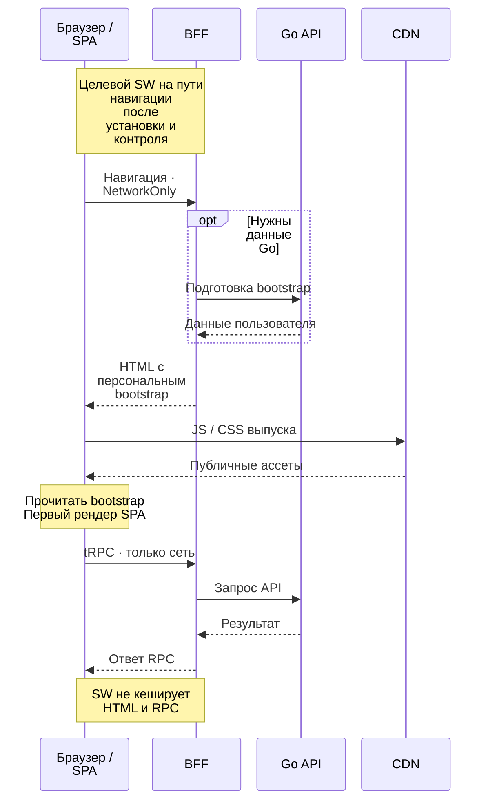
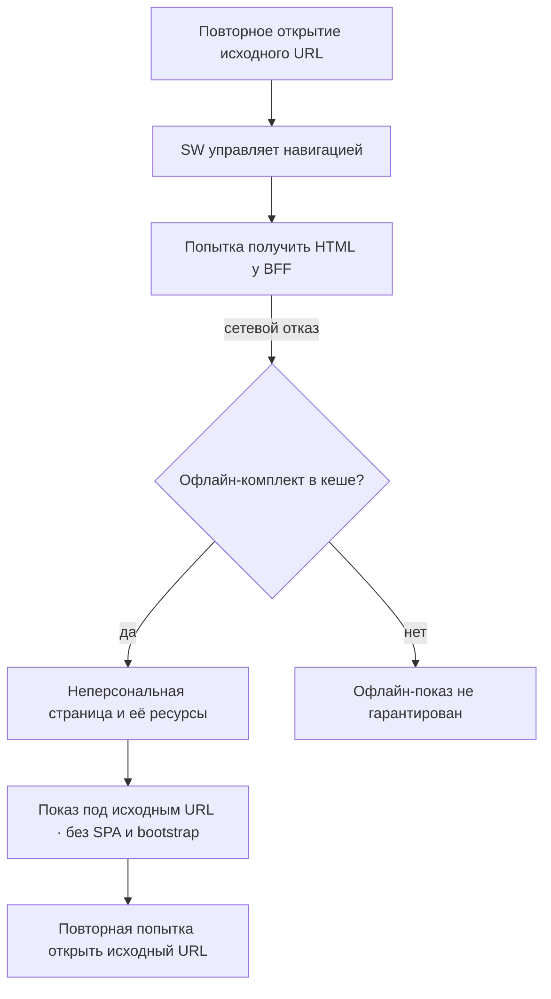
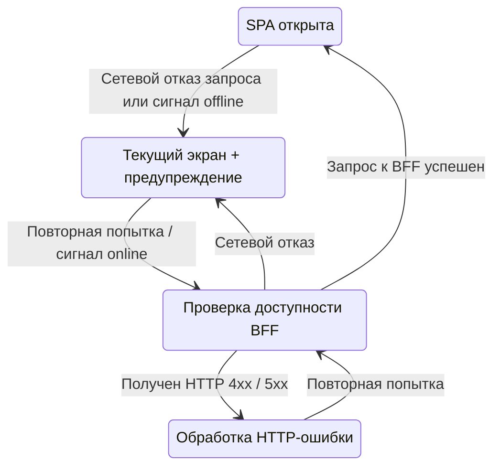

# Архитектура офлайн-режима Cellestial

::: info Целевое устройство трека
Здесь описано поведение, которое предстоит спроектировать и реализовать. Эта страница не утверждает,
что офлайн-режим уже готов или проверен в проде. Основные понятия разобраны в [теории](./theory).
:::

## Основа: SPA и BFF

Исходники frontend на SHA `6b4a7773e3cde056107dddd2912778b6a5691560` подтверждают основу:
BFF добавляет персональный bootstrap в HTML и выставляет `no-store`, клиент читает bootstrap
перед первым рендером, а прод-сборка использует отдельный CDN-каталог выпуска.
Это факты о коде, без свидетельства выкладки:
[BFF и HTML](https://github.com/Cringe-Driven-Development-Team/frontend/blob/6b4a7773e3cde056107dddd2912778b6a5691560/apps/bff/src/html.ts#L10-L44),
[старт клиента](https://github.com/Cringe-Driven-Development-Team/frontend/blob/6b4a7773e3cde056107dddd2912778b6a5691560/apps/client/src/main.tsx#L16-L36),
[CDN в сборке](https://github.com/Cringe-Driven-Development-Team/frontend/blob/6b4a7773e3cde056107dddd2912778b6a5691560/apps/client/vite.config.prod.ts#L4-L13).

У этой основы есть архитектурное следствие: сохранённый HTML может содержать данные пользователя,
а запуск SPA зависит от bootstrap. Выбранная офлайн-страница должна быть самостоятельной.
Контекст серверного HTML — в учебном документе [«Серверный bootstrap»](../bff/bootstrap).

## Открытие с сетью

Целевое дополнение — SW, доступный после установки и получения управления страницей.
Первое открытие может пройти без него. Основной поток остаётся сетевым: BFF формирует HTML,
клиент получает ассеты и читает bootstrap до первого рендера; дальнейшие tRPC-запросы идут через BFF
к Go API. Обращение BFF к Go при подготовке bootstrap зависит от состояния сессии.

Для навигации выбран **NetworkOnly**, с отдельной офлайн-подстановкой при сетевом отказе.
Это не NetworkFirst: прошлый персональный HTML не используется как запасной ответ.

Полученные HTTP-ответы `401`, `403`, `404`, `503` сохраняют смысл своего статуса. В частности,
HTML `503` от BFF не заменяется офлайн-страницей автоматически: сервер вернул ответ.
Сетевой отказ означает, что ответа получить не удалось; сам по себе он не доказывает отсутствие
интернета у устройства. Различие статуса и отказа запроса объясняет
[MDN о Fetch](https://developer.mozilla.org/en-US/docs/Web/API/Fetch_API/Using_Fetch).

## Открытие без сети

Повторное открытие может показать заранее сохранённую неперсональную офлайн-страницу. Для этого
должны быть готовы и SW с подходящим scope, и кеш страницы вместе со всеми нужными ей ресурсами.
Она не требует bootstrap, входа, запуска SPA или обращения к CDN для своего показа.

SW подставляет ответ под исходный адрес, без перенаправления на отдельный URL офлайн-страницы.
Поэтому повторная попытка открывает нужную пользователю страницу. Это запасной неперсональный
ответ на навигацию, а не восстановленная сессия и не сохранённый экран SPA.
[Понятие fallback — Workbox](https://developer.chrome.com/docs/workbox/managing-fallback-responses).

## Потеря сети в открытом приложении

Уже открытая SPA сохраняет текущий экран и показывает предупреждение о проблеме соединения.
Автоматической замены экрана офлайн-страницей нет. Ошибка запроса не означает выход из аккаунта;
сетевой сбой нельзя превращать в гостевую сессию.

`navigator.onLine` и события `online` / `offline` — подсказки для интерфейса. Доступность BFF
определяет результат запроса к нему: локальная сеть может быть доступна, а BFF — нет, и наоборот.
Отказ сервера не доказывает отсутствие интернета. HTTP-ошибка обрабатывается как HTTP-ошибка,
а восстановление сигнала `online` ещё не доказывает успешность запроса.
[Ограничения индикатора — MDN](https://developer.mozilla.org/en-US/docs/Web/API/Navigator/onLine).

## Что кешируем

Политика относится к типу ресурса и его содержимому. Наличие BFF само по себе не запрещает
кеширование: персональный HTML исключён осознанным решением. Заголовок `no-store` не заменяет
этого запрета в Cache API, как разобрано в [теории](./theory).

| Ресурс | Источник и выбранное поведение | Граница кеша SW |
| --- | --- | --- |
| Навигационный HTML BFF | NetworkOnly; при сетевом отказе — отдельная офлайн-страница | Персональный HTML не кешируем; полученный HTML 503 тоже не сохраняем |
| RPC / API | NetworkOnly; сетевые и серверные ошибки остаются ошибками RPC | Ответы и личные данные не кешируем; HTML в RPC не подставляем |
| Офлайн-страница и нужные ей ресурсы | Precache до возникновения офлайн-сценария; локальный показ при отказе навигации | Только неперсональный самостоятельный комплект |
| Публичные версионированные JS / CSS и другие ассеты | Допустимы precache или runtime caching по обоснованной стратегии | Только явно выбранные публичные ресурсы; наличие кеша части ассетов не означает готовность всей SPA офлайн |

Очередь отложенных записей не входит в объём: неуспешная операция не должна выглядеть сохранённой.

## Размещение и обновление

SW должен раздаваться с origin приложения, а его scope — охватывать нужные навигации.
Адрес CDN для JS/CSS автоматически не задаёт адрес SW. Origin и scope ограничивают управление
страницами; они не запрещают контролируемой странице обращаться за ассетами к CDN.
[Scope и управление — Chrome](https://developer.chrome.com/docs/workbox/service-worker-lifecycle).

Сборка отвечает за согласованные файлы SW, офлайн-страницы и её ресурсов; публичная раздача BFF —
за их получение браузером; браузер — за установку, активацию и локальный кеш. Публичная
офлайн-страница должна быть доступна без проверки сессии и без вставки персонального bootstrap.
Конкретные маршруты, параметры плагина и способ сборки студент выбирает и проверяет самостоятельно.

SW, его кеш и офлайн-страница обновляются как согласованный комплект. Важно объяснить поведение
открытой вкладки при появлении новой версии: она может ещё использовать прежний контроллер.
Принудительная перезагрузка работающей вкладки не является универсальным решением.
[Обновление SW — Chrome](https://developer.chrome.com/docs/workbox/service-worker-lifecycle).

## Границы режима

Первый визит сразу без сети не гарантирует офлайн-страницу: сохранять её было некому.
Удалённый кеш или незавершённая установка дают тот же предел. Даже предыдущий онлайн-визит
сам по себе не доказывает готовность комплекта. Пользователь и браузер могут удалить локальные
данные — это нужно учитывать в сценариях проверки.
[Сохранность Cache Storage — MDN](https://developer.mozilla.org/en-US/docs/Web/API/Cache).

Офлайн-страница не предоставляет личных данных, редактирования или фонового повторения записей.
Кеширование личных данных технически возможно и с BFF, и без него, но потребовало бы отдельной
продуктовой политики: что делать с истёкшей сессией, выходом и доступом другого человека к устройству.
Этот трек такой политики не задаёт. Сетевая ошибка не заменяет решение сервера об авторизации.

## Вопросы для реализации

- Как доказать, что навигационный HTML и RPC никогда не попадают в выбранные кеши SW?
- От каких ресурсов зависит офлайн-страница и как проверить её независимость от SPA, сессии и CDN?
- Как отличить навигацию от RPC, сетевой отказ от полученного HTTP-ответа?
- Что будет с исходным URL при офлайн-подстановке и последующей повторной попытке?
- Какой режим плагина подходит требованиям и какую ответственность оставляет разработчику?
- Как пользователь поймёт состояние соединения, не потеряв открытый экран и введённые данные?
- Как проверить согласованность нового SW, кеша и страницы при открытой вкладке?

Ответ должен содержать обоснование поведения и собственные проверки; схемы не задают готовый
обработчик запроса или конфигурацию плагина.

## Сценарии проверки

*Проверить после реализации; эта документация не является отчётом о выполнении сценариев.*

| Сценарий | Ожидаемое наблюдение |
| --- | --- |
| Онлайн-навигация гостя и вошедшего пользователя | Свежий HTML BFF; bootstrap до первого рендера; персональных ответов в кешах SW нет |
| Повторное открытие после готовности SW и офлайн-комплекта, сеть отключена | Неперсональная страница под исходным URL, включая прямую ссылку; нет зависимости от запуска SPA и CDN |
| Повторная попытка после восстановления BFF | Открывается исходный адрес и заново получается сетевой HTML |
| Первый визит без сети, удалённый кеш, прерванная установка | Отсутствие офлайн-страницы допустимо; нет ложной гарантии готовности |
| Потеря сети в уже открытой SPA и неуспешная запись | Текущий экран и предупреждение; нет выхода, подмены экрана или обещания отложенного сохранения |
| Сигнал online при недоступном BFF | Индикатор не выдаёт сигнал за доказательство успешного запроса |
| HTTP 401 / 403 / 404 / HTML 503 и отдельно сетевой отказ | Сохраняется смысл HTTP-ответов; офлайн-подстановка применяется только к отказу навигации, HTML не попадает в RPC |
| Новая версия при открытой вкладке | Проверена согласованность SW, кеша и офлайн-страницы; политика обновления не теряет работу пользователя |

Вернуться к [теории офлайн-режима](./theory) или к [треку «Офлайн-режим»](../offline).
