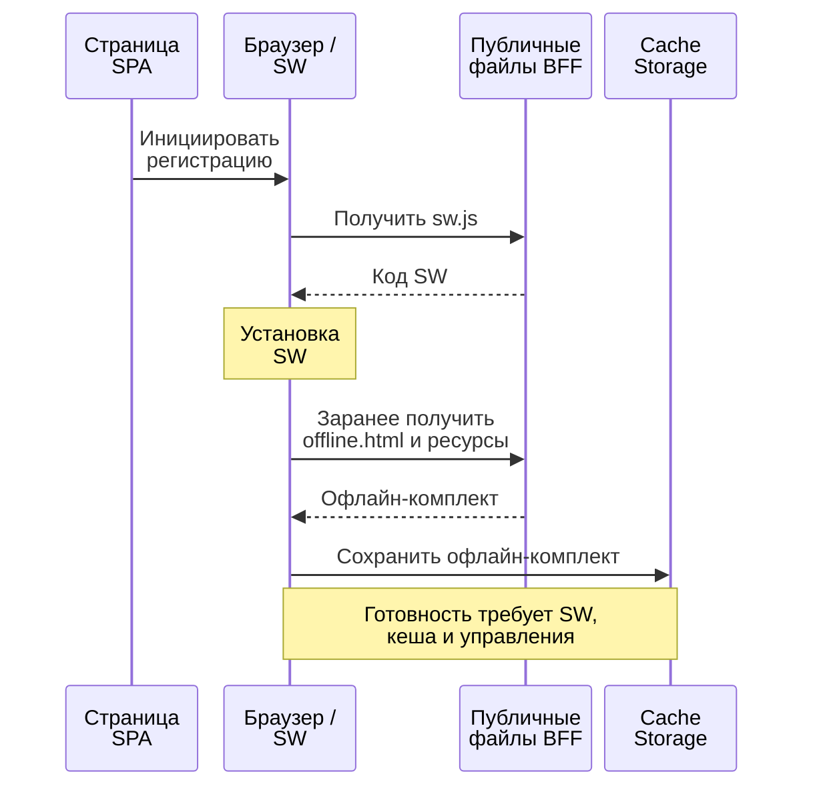
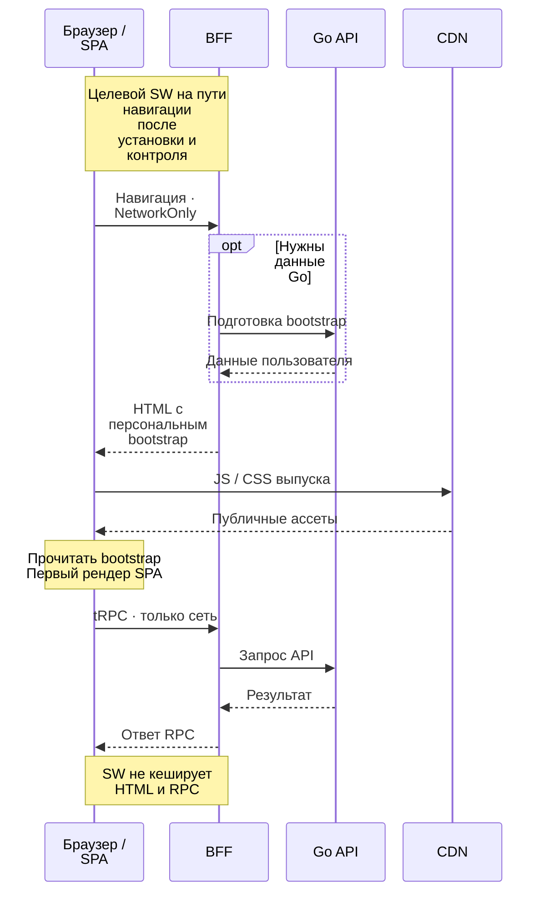
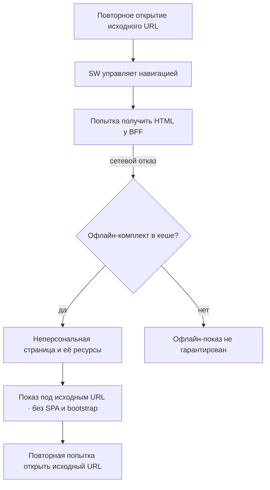
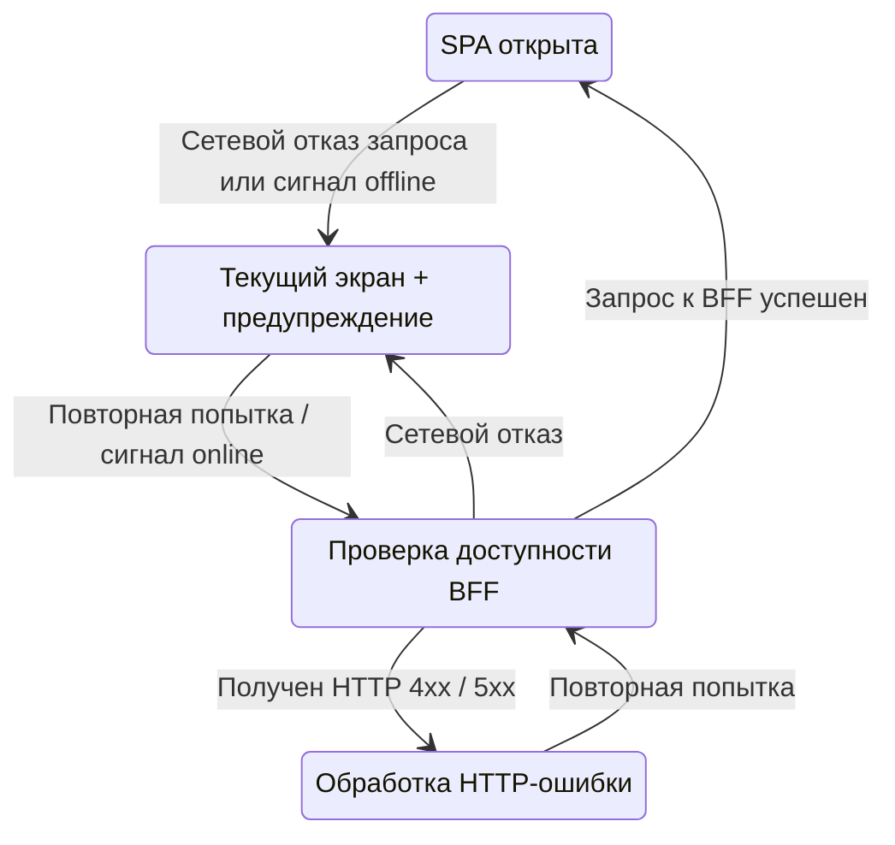

# Архитектура офлайн-режима Cellestial

::: info Сделано
Реализация и проверенные сценарии описаны в [офлайн-режиме](/documentation/offline/),
связь инструментов и настроек — в [сборке и регистрации SW](/documentation/offline/build-and-registration).
Ниже сохранён учебный план и его архитектурные объяснения.
:::

::: info Целевое устройство трека
Здесь описано поведение, которое предстоит спроектировать и реализовать. Эта страница не утверждает,
что офлайн-режим уже готов или проверен в проде. Основные понятия разобраны в [теории](./theory).
:::

## Основа: SPA и BFF

Исходники frontend на SHA `6b4a7773e3cde056107dddd2912778b6a5691560` подтверждают основу:
BFF добавляет персональный bootstrap в HTML и выставляет `no-store`, клиент читает bootstrap
перед первым рендером, а прод-сборка использует отдельный CDN-каталог выпуска.
Это факты о коде, без свидетельства выкладки:
[BFF и HTML](https://github.com/Cringe-Driven-Development-Team/frontend/blob/6b4a7773e3cde056107dddd2912778b6a5691560/apps/bff/src/html.ts#L10-L44),
[старт клиента](https://github.com/Cringe-Driven-Development-Team/frontend/blob/6b4a7773e3cde056107dddd2912778b6a5691560/apps/client/src/main.tsx#L16-L36),
[CDN в сборке](https://github.com/Cringe-Driven-Development-Team/frontend/blob/6b4a7773e3cde056107dddd2912778b6a5691560/apps/client/vite.config.prod.ts#L4-L13).

У этой основы есть архитектурное следствие: сохранённый HTML может содержать данные пользователя,
а запуск SPA зависит от bootstrap. Выбранная офлайн-страница должна быть самостоятельной.
Контекст серверного HTML — в учебном документе [«Серверный bootstrap»](../bff/bootstrap).

<DiagramSection>

## Подготовка офлайн-режима

Пока сеть доступна, страница SPA инициирует регистрацию SW в браузере. Её JS может прийти с CDN:
он выполняется в контексте страницы приложения на `https://cellestial.ru`. BFF не регистрирует SW —
он публично раздаёт файлы, которые запрашивает браузер.

Целевые адреса: `https://cellestial.ru/sw.js` со scope `/` и `https://cellestial.ru/offline.html`.
Браузер получает SW с BFF; во время установки SW заранее получает от BFF офлайн-страницу
и все обязательные для неё ресурсы и сохраняет этот комплект в Cache Storage.

<template #diagram>

</template>

Регистрация сама по себе не гарантирует готовность: загрузка или сохранение комплекта могут
прерваться. Активация SW и получение управления страницей — отдельные этапы жизненного цикла;
успешная регистрация не означает, что текущая вкладка уже под его управлением.

</DiagramSection>

<DiagramSection>

## Открытие с сетью

Целевое дополнение — SW, доступный после установки и получения управления страницей.
Первое открытие может пройти без него. Основной поток остаётся сетевым: BFF формирует HTML,
клиент получает ассеты и читает bootstrap до первого рендера; дальнейшие tRPC-запросы идут через BFF
к Go API. Обращение BFF к Go при подготовке bootstrap зависит от состояния сессии.

<template #diagram>

</template>

Для навигации выбран **NetworkOnly**, с отдельной офлайн-подстановкой при сетевом отказе.
Это не NetworkFirst: прошлый персональный HTML не используется как запасной ответ.

Полученные HTTP-ответы `401`, `403`, `404`, `503` сохраняют смысл своего статуса. В частности,
HTML `503` от BFF не заменяется офлайн-страницей автоматически: сервер вернул ответ.
Сетевой отказ означает, что ответа получить не удалось; сам по себе он не доказывает отсутствие
интернета у устройства. Различие статуса и отказа запроса объясняет
[MDN о Fetch](https://developer.mozilla.org/en-US/docs/Web/API/Fetch_API/Using_Fetch).

</DiagramSection>

<DiagramSection>

## Открытие без сети

Повторное открытие может показать заранее сохранённую неперсональную офлайн-страницу. Для этого
должны быть готовы и SW с подходящим scope, и кеш страницы вместе со всеми нужными ей ресурсами.
Она не требует bootstrap, входа, запуска SPA или обращения к CDN для своего показа.

<template #diagram>

</template>

SW подставляет ответ под исходный адрес, без перенаправления на отдельный URL офлайн-страницы.
Поэтому повторная попытка открывает нужную пользователю страницу. Это запасной неперсональный
ответ на навигацию, а не восстановленная сессия и не сохранённый экран SPA.
[Понятие fallback — Workbox](https://developer.chrome.com/docs/workbox/managing-fallback-responses).

</DiagramSection>

<DiagramSection>

## Потеря сети в открытом приложении

Уже открытая SPA сохраняет текущий экран и показывает предупреждение о проблеме соединения.
Автоматической замены экрана офлайн-страницей нет. Ошибка запроса не означает выход из аккаунта;
сетевой сбой нельзя превращать в гостевую сессию.

<template #diagram>

</template>

`navigator.onLine` и события `online` / `offline` — подсказки для интерфейса. Доступность BFF
определяет результат запроса к нему: локальная сеть может быть доступна, а BFF — нет, и наоборот.
Отказ сервера не доказывает отсутствие интернета. HTTP-ошибка обрабатывается как HTTP-ошибка,
а восстановление сигнала `online` ещё не доказывает успешность запроса.
[Ограничения индикатора — MDN](https://developer.mozilla.org/en-US/docs/Web/API/Navigator/onLine).

</DiagramSection>

## Что кешируем

Политика относится к типу ресурса и его содержимому. Наличие BFF само по себе не запрещает
кеширование: персональный HTML исключён осознанным решением. Заголовок `no-store` не заменяет
этого запрета в Cache API, как разобрано в [теории](./theory).

| Ресурс | Кешируем в Cache Storage | Источник и выбранное поведение |
| --- | --- | --- |
| Навигационный HTML BFF | Нет | BFF; NetworkOnly, при сетевом отказе — отдельная офлайн-страница |
| RPC / API | Нет | BFF → Go API; NetworkOnly, ошибки остаются ошибками RPC |
| Офлайн-страница | Да | Публичная статика BFF; precache во время установки SW |
| Обязательные ресурсы офлайн-страницы | Да | Публичная статика BFF; precache вместе со страницей |
| Остальные JS/CSS SPA и ассеты CDN | Нет | CDN; загрузка по сети для обычной SPA |

Персональный HTML, включая полученный HTML 503, ответы RPC и личные данные не кешируем;
HTML в RPC не подставляем. Публичные версионированные ассеты SPA также не включаем в Cache Storage
в выбранном минимальном сценарии: офлайн показывается только самостоятельный неперсональный комплект.
Обычный HTTP-кеш браузера — отдельный механизм, эта таблица задаёт политику Cache Storage приложения.
Сам `sw.js` браузер сохраняет как установленный Service Worker; это не запись в Cache Storage
и не требование кешировать SW самим собой.

Очередь отложенных записей не входит в объём: неуспешная операция не должна выглядеть сохранённой.

## Размещение и обновление {#размещение-и-обновление}

SW, кеш и неперсональная страница образуют согласованный комплект. Адрес, scope, ответственность
участников и правила для открытой вкладки — в [размещении и обновлении](./deployment#размещение-и-обновление).

## Границы режима

- **Первый визит сразу без сети** не гарантирует офлайн-страницу: сохранять её было некому.
- **Удалённый кеш или незавершённая установка** дают тот же предел. Даже предыдущий онлайн-визит
  сам по себе не доказывает готовность комплекта.
- **Локальные данные** может удалить пользователь или браузер — это нужно учитывать в сценариях проверки.

[Сохранность Cache Storage — MDN](https://developer.mozilla.org/en-US/docs/Web/API/Cache).

Офлайн-страница не предоставляет личных данных, редактирования или фонового повторения записей.
Кеширование личных данных технически возможно и с BFF, и без него, но потребовало бы отдельной
продуктовой политики: что делать с истёкшей сессией, выходом и доступом другого человека к устройству.
Этот трек такой политики не задаёт. Сетевая ошибка не заменяет решение сервера об авторизации.

## Вопросы для реализации {#вопросы-для-реализации}

Обоснуйте регистрацию, готовность комплекта, разделение запросов и поведение открытой вкладки.
Полный список — в [вопросах для реализации](./checks#вопросы-для-реализации).

## Сценарии проверки {#сценарии-проверки}

Проверить после реализации: подготовку, онлайн- и офлайн-потоки, ошибки, локальные данные и обновление.
Ожидаемые наблюдения — в [сценариях проверки](./checks#сценарии-проверки).

Далее — [размещение и обновление](./deployment), затем [проверка офлайн-режима](./checks).
Вернуться к [теории офлайн-режима](./theory) или к [треку «Офлайн-режим»](../offline).
