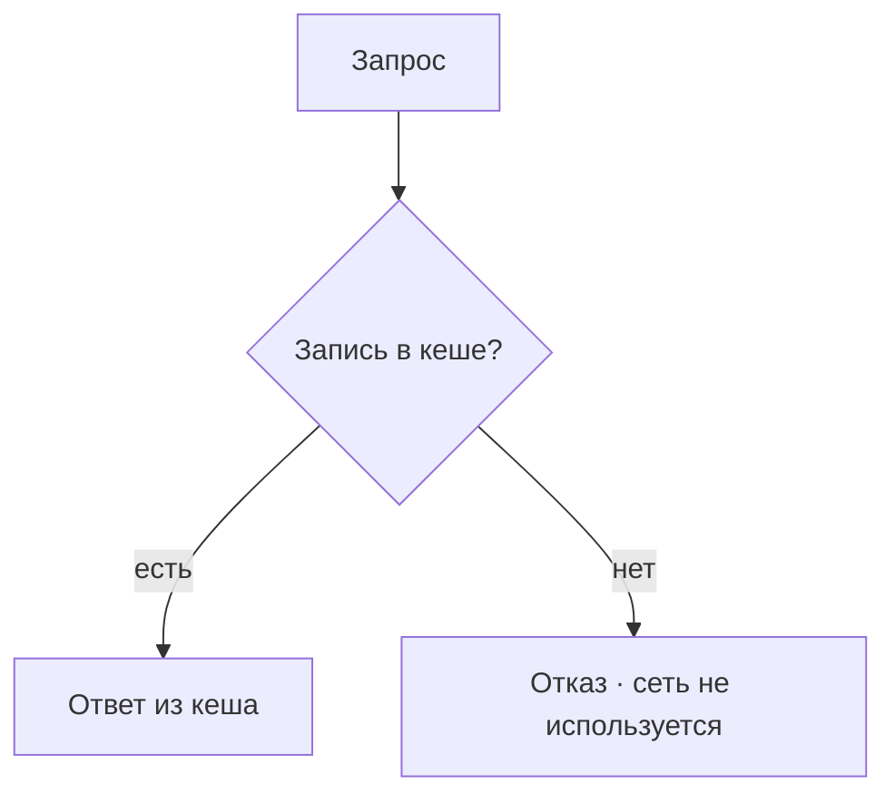
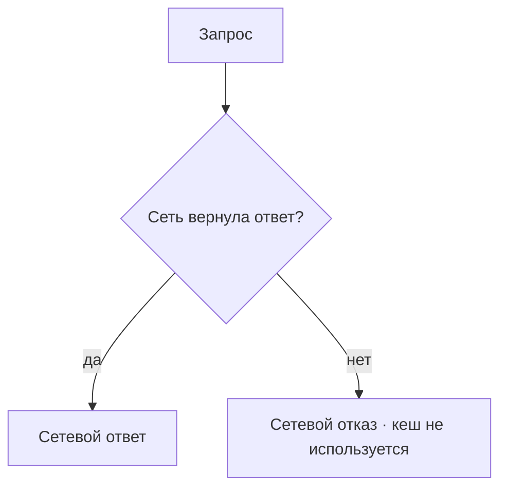
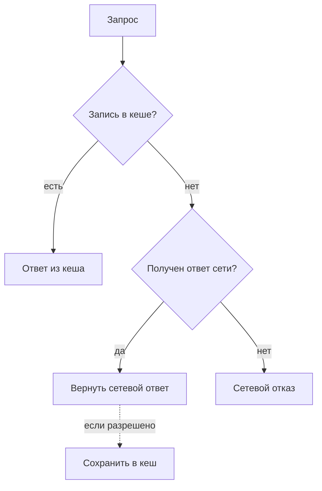
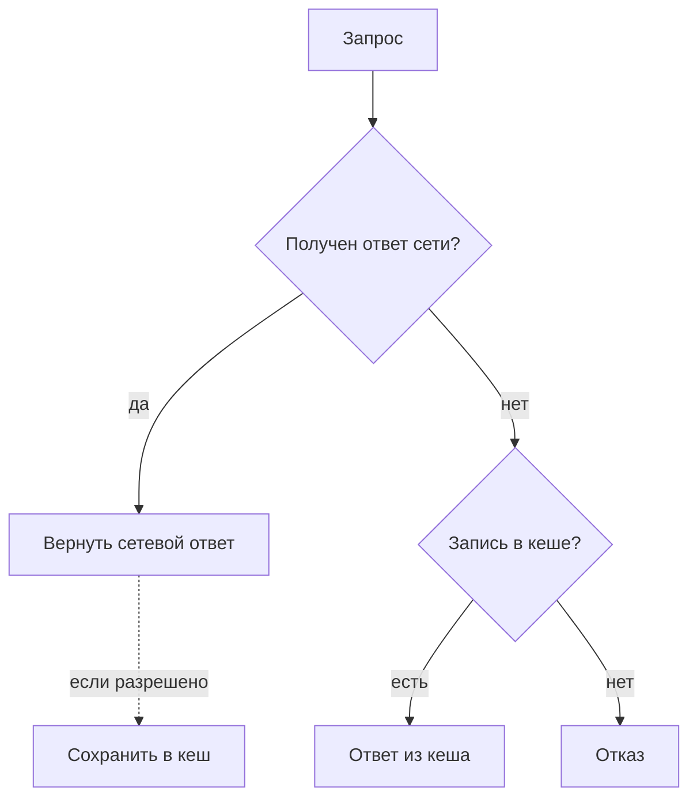
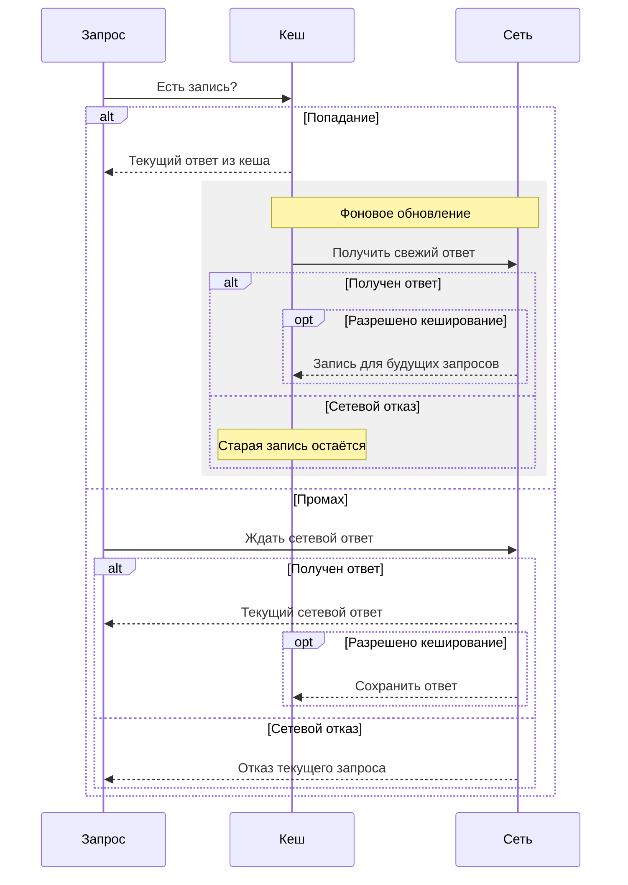

# Стратегии кеширования

::: info Сделано
Реализация и проверенные сценарии описаны в [офлайн-режиме](/documentation/offline/),
связь инструментов и настроек — в [сборке и регистрации SW](/documentation/offline/build-and-registration).
Ниже сохранён учебный план и его архитектурные объяснения.
:::

Стратегия определяет, откуда взять ответ на текущий запрос. Хранение и наполнение кеша разобраны
в [теории офлайн-режима](./theory); здесь сравним пять порядков обращения к кешу и сети.

## Перед выбором стратегии

Получение сетевого ответа и разрешение сохранить его — разные факты. Если стратегия выбрала сеть
для текущего запроса, полученный HTTP-ответ возвращается ему независимо от статуса; запись в кеш
зависит от отдельной политики.
Некешируемый HTTP 503 сам по себе не означает сетевой отказ и не переключает стратегию на старый кеш.
[Допустимость кеширования — Workbox](https://developer.chrome.com/docs/workbox/modules/workbox-cacheable-response).
Схемы показывают порядок источников, без настройки таймаутов, маршрутов или кешей.
[Определения стратегий — Workbox](https://developer.chrome.com/docs/workbox/modules/workbox-strategies/),
[сценарии кеширования — web.dev](https://web.dev/articles/offline-cookbook).

## CacheOnly

Источник — только кеш; отсутствующая запись означает отказ, даже при доступной сети.

## NetworkOnly

Источник — только сеть; стратегия не записывает ответ в Cache Storage. Сетевой отказ передаётся
дальше, если отдельно не предусмотрена подстановка. Обычный HTTP-кеш остаётся отдельным механизмом.

## CacheFirst

Сначала кеш; при промахе — сетевой ответ независимо от разрешения кешировать. В кеш попадают
только разрешённые политикой ответы. Найденная запись может устареть.

## NetworkFirst

Сначала сеть: полученный ответ возвращается, а сохранение разрешается отдельно. Только если сеть
не вернула ответ, стратегия обращается к существующей записи кеша.

## StaleWhileRevalidate

При попадании текущий запрос получает кеш, а сеть запрашивается в фоне. Запись обновляется, только
если ответ разрешено кешировать; иначе прежняя остаётся. При промахе текущий запрос получает
сетевой ответ независимо от разрешения кешировать. Новая запись сама по себе не меняет уже
показанный экран.

## Сравнение стратегий

| Стратегия | Источник текущего ответа | Обращение к сети | Свежесть и предел |
| --- | --- | --- | --- |
| CacheOnly | Кеш | Нет | Зависит от наполнения; промах — отказ |
| NetworkOnly | Сеть | Всегда | Ответ сети; без неё — отказ |
| CacheFirst | Кеш, затем сеть | При промахе | Кеш может устареть; без обоих источников — отказ |
| NetworkFirst | Сеть, затем кеш | Сначала сеть | Сетевой ответ; если ответа нет — возможен старый |
| StaleWhileRevalidate | Кеш либо сеть при промахе | Всегда | При попадании сейчас старый ответ, обновление для будущего |

Далее — [архитектура офлайн-режима Cellestial](./architecture): какие запросы и ресурсы входят
в выбранный сценарий. Вернуться к [треку «Офлайн-режим»](../offline).
