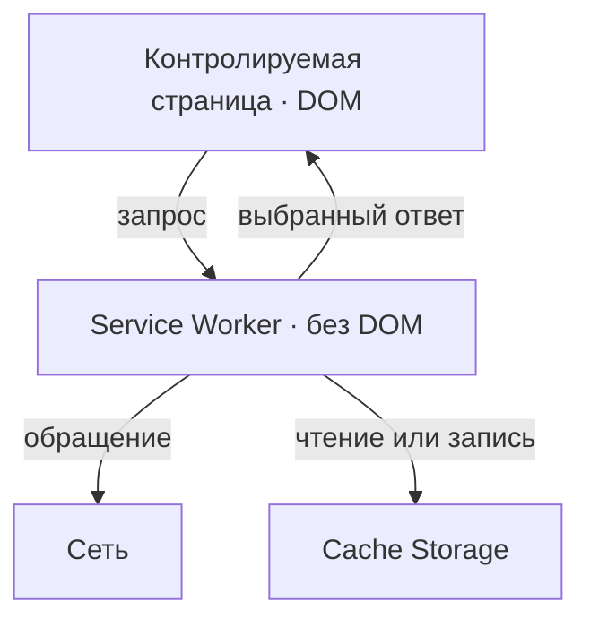
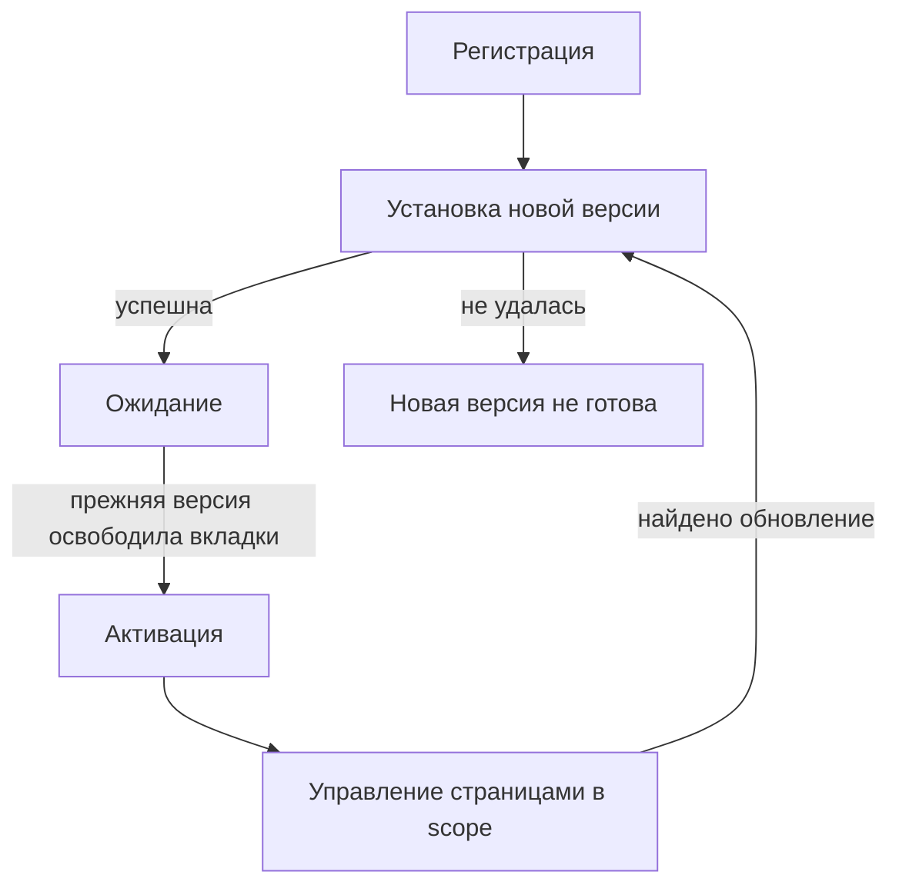
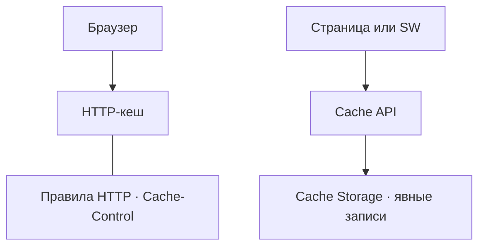
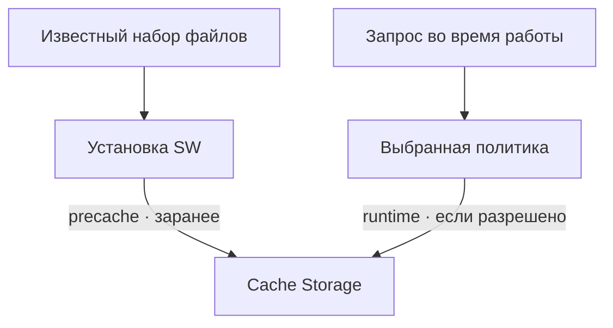
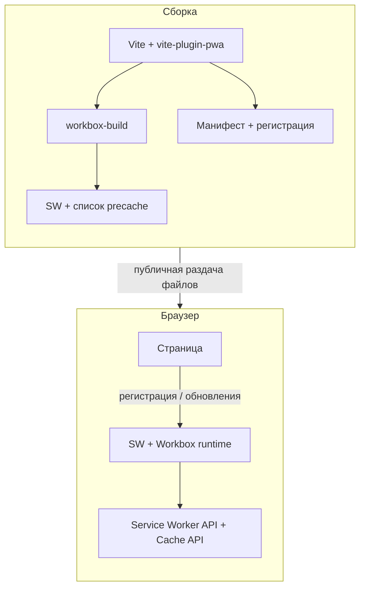

# Теория офлайн-режима

Сначала разберём, кто отвечает на запрос, где лежит сохранённый ответ и когда он появляется.
Затем сравните [стратегии кеширования](./caching-strategies) и примените понятия
в [архитектуре Cellestial](./architecture).

## Service Worker

Service Worker (SW) — событийный JavaScript-контекст браузера, отдельный от страницы и без доступа
к DOM. Он может перехватывать запросы контролируемой страницы и выбирать ответ. Браузер вправе
остановить его между событиями: постоянно работающим сервером SW не является.
[Устройство SW — MDN](https://developer.mozilla.org/en-US/docs/Web/API/Service_Worker_API).

Для SW нужен безопасный контекст: в приложении это HTTPS, а localhost допускается для разработки.
Регистрация связана с origin, а scope ограничивает адреса управляемых страниц. Страница вне scope
не становится контролируемой этим SW. URL внешнего ресурса и scope страницы — разные вещи.
[Условия работы — MDN](https://developer.mozilla.org/en-US/docs/Web/API/Service_Worker_API/Using_Service_Workers).

## Жизненный цикл

Регистрация сообщает браузеру о SW. Установка подготавливает новую версию; при обновлении она
обычно ждёт, пока прежняя перестанет управлять вкладками. Затем происходит активация. Управление
страницей — отдельный факт: успешная регистрация сама по себе не доказывает ни контроль текущей
страницы, ни наличие файлов для офлайн-показа.
[Жизненный цикл — Chrome](https://developer.chrome.com/docs/workbox/service-worker-lifecycle).

При первой установке прежнего SW нет, поэтому ждать его вкладки не требуется. Уже открытая
страница при этом не обязательно сразу получает контроллер. При обновлении некоторое время
сосуществуют работающая и ожидающая версии. Принудительная смена контроллера и перезагрузка
могут прервать работу вкладки; политику обновления нужно обосновать отдельно.

## Где хранится кеш

HTTP-кеш браузера использует HTTP-правила свежести и проверки ответов. Cache Storage хранит
именованные наборы пар Request/Response, которыми приложение управляет через Cache API.
[HTTP-кеш — MDN](https://developer.mozilla.org/en-US/docs/Web/HTTP/Guides/Caching),
[Cache API — MDN](https://developer.mozilla.org/en-US/docs/Web/API/Cache).

Заголовок `Cache-Control: no-store` не запрещает скрипту явно сохранить ответ через Cache API.
Поэтому исключение личных данных должно быть частью политики SW. Cache Storage не обновляет
записи автоматически; сохранность тоже не вечна: данные может удалить пользователь или браузер.
Это локальное хранилище конкретного браузерного профиля, а не общий кеш сервера.

## Когда наполняется кеш

**Precache** сохраняет заранее выбранный набор ресурсов, обычно при установке SW.
**Runtime caching** пополняет кеш во время обработки реальных запросов.
[Precache в Workbox](https://developer.chrome.com/docs/workbox/modules/workbox-precaching).

Это ответ на вопрос «когда появилась запись». Стратегия отвечает на другой вопрос — «откуда взять
ответ сейчас». Наличие SW не означает, что он сохраняет все запросы. Precache тоже требует сети
при первоначальном получении файлов и не помогает первому визиту сразу без сети.

## Стратегии кеширования {#стратегии-кеширования}

Стратегия выбирает источник ответа, а разрешение сохранить его задаётся отдельно.
Пять схем и общие оговорки — в [стратегиях кеширования](./caching-strategies#стратегии-кеширования).

### CacheOnly {#cacheonly}

CacheOnly отвечает только из кеша; промах означает отказ.
[Порядок обработки и схема](./caching-strategies#cacheonly).

### NetworkOnly {#networkonly}

NetworkOnly использует только сеть и не записывает ответ в Cache Storage.
[Порядок обработки и схема](./caching-strategies#networkonly).

### CacheFirst {#cachefirst}

CacheFirst начинает с кеша и обращается к сети при промахе.
[Порядок обработки и схема](./caching-strategies#cachefirst).

### NetworkFirst {#networkfirst}

NetworkFirst обращается к кешу, только если сеть не вернула ответ.
[Порядок обработки и схема](./caching-strategies#networkfirst).

### StaleWhileRevalidate {#stalewhilerevalidate}

StaleWhileRevalidate при попадании возвращает кеш и обновляет его в фоне для будущих запросов.
[Порядок обработки и схема](./caching-strategies#stalewhilerevalidate).

## Workbox

Workbox — семейство npm-пакетов поверх браузерных API. Их задачи и среда выполнения различаются:

| Пакет | Где работает | За что отвечает |
| --- | --- | --- |
| `workbox-build` | При сборке | Генерирует SW или подставляет список precache в написанный SW |
| `workbox-routing` | В Service Worker | Выбирает обработчик запроса |
| `workbox-strategies` | В Service Worker | Реализует стратегии кеширования |
| `workbox-precaching` | В Service Worker | Управляет заранее выбранными файлами |
| `workbox-window` | На странице | Помогает с регистрацией SW и обновлениями |

Браузер выполняет SW, а не сборщик Vite.
[Карта пакетов Workbox](https://developer.chrome.com/docs/workbox/modules/).

Общая схема с плагином ниже отделяет подготовку файлов от их выполнения.

## vite-plugin-pwa

Плагин связывает Vite с подготовкой веб-манифеста, SW, его регистрации и обновления.
При сборке плагин использует `workbox-build` для режимов `generateSW` и `injectManifest`.
Манифест описывает приложение для браузера; возможность установки PWA и работа без сети —
разные свойства. Сам факт установки не доказывает доступность нужного ресурса офлайн.
[Возможности плагина — Vite PWA](https://vite-pwa-org.netlify.app/guide/).

Два режима определяют, **кто пишет SW**:

- [generateSW](https://vite-pwa-org.netlify.app/workbox/generate-sw.html): Workbox генерирует SW
  по описанным требованиям; разработчик отвечает за выбор поведения.
- [injectManifest](https://vite-pwa-org.netlify.app/workbox/inject-manifest.html): разработчик пишет
  SW, а сборка подставляет список precache в подготовленный код.

Эти режимы не являются стратегиями CacheFirst или NetworkFirst. Выбор способа сборки не заменяет
решений о запросах, приватности и ошибках. Связь инструмента и Workbox описана в
[документации интеграции](https://vite-pwa-org.netlify.app/workbox/).

## Что проверить в понимании

- Почему успешно зарегистрированный SW ещё не гарантирует офлайн-страницу?
- Какие три разных решения скрываются за словами «кешировать ресурс»: где, когда и как отвечать?
- Почему `no-store` недостаточно для запрета записи личного HTML в Cache Storage?
- При каких условиях каждая из пяти стратегий завершится отказом?
- Что получит текущий запрос SWR, а что изменится только для следующего?
- Чем отличается ответственность автора SW в generateSW и injectManifest?

Далее — [пять стратегий кеширования](./caching-strategies), затем
[архитектура офлайн-режима Cellestial](./architecture).
Вернуться к [треку «Офлайн-режим»](../offline).
