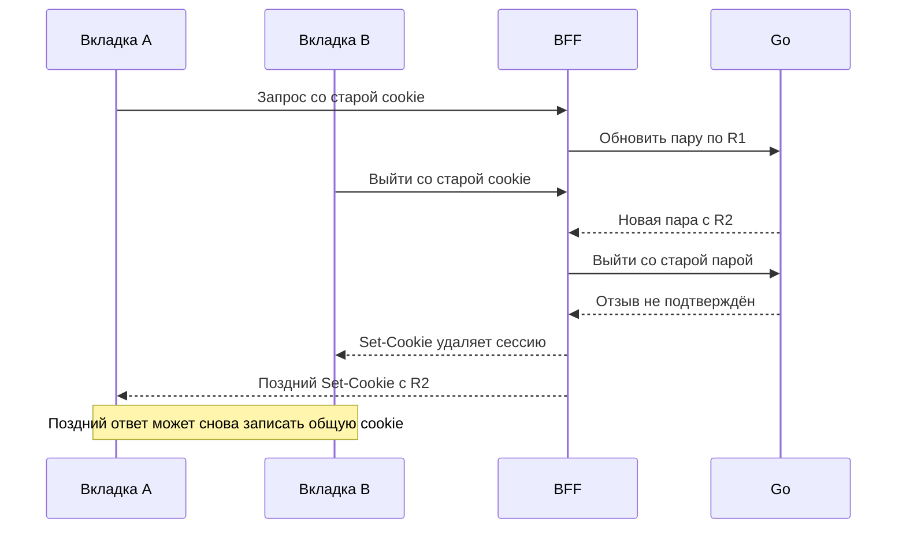
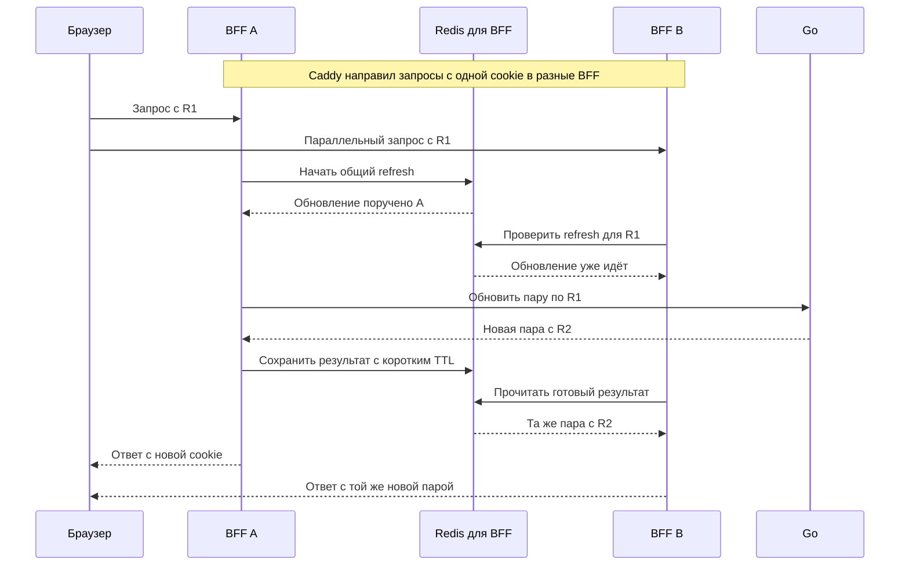

Сейчас BFF объединяет одновременные refresh-запросы в памяти одного процесса. При переходе на два BFF нужно, чтобы оба экземпляра могли получить один и тот же результат обновления. Ниже — зачем это нужно и как можно пережить отказ Redis. Схема с несколькими экземплярами относится к [плану #211](https://github.com/Cringe-Driven-Development-Team/frontend/issues/211).

## Один BFF: refresh и logout {#refresh-и-logout}

Вкладки одного сайта в браузере используют общую cookie. Если ответ с новой cookie уже получен, следующая вкладка отправит её автоматически. Гонка возникает, когда запросы уже ушли со старой cookie.

Текущий BFF выполняет один refresh для запросов с одним токеном и хранит успешный результат 10 секунд. Logout из другой вкладки не ждёт этот refresh. В показанном порядке Go уже выдал новую пару, а logout ещё использует старую. Ответ с новой cookie может прийти после ответа, который её удаляет. [Код refresh](https://github.com/Cringe-Driven-Development-Team/frontend/blob/847eba337b76531681ab40f0831c6fe6988aea23/apps/bff/src/session/refresh.ts#L17-L19) · [Задача #142](https://github.com/Cringe-Driven-Development-Team/frontend/issues/142)

Если Go подтвердил отзыв, поздняя cookie не вернёт доступ: Go отклонит отозванную сессию. Задача #142 согласует refresh и logout в одном BFF, включая ожидание начатого refresh и запрет выдачи старой cookie после выхода.

## Горизонтальное масштабирование BFF {#масштабирование}

В проверенной конфигурации Caddy направляет запросы в один BFF. Чтобы распределить нагрузку, можно запустить два одинаковых экземпляра за Caddy с общим `SESSION_KEY`. Тогда оба прочтут одну зашифрованную cookie, но у каждого будет своя память. Если один и тот же refresh-токен уже пришёл на оба BFF, локальная координация не предотвратит два вызова Go. Go принимает этот токен только один раз. [Конфигурация Caddy](https://github.com/Cringe-Driven-Development-Team/infra/blob/0d4cb15/ansible/roles/caddy/templates/Caddyfile.j2#L41) · [Ротация в Go](https://github.com/Cringe-Driven-Development-Team/backend/blob/7f511909914249c17ec235d4365b0a68cf204da3/internal/user/usecase/user.go#L125-L142)

Вариант для двух BFF — оставить пару в зашифрованной cookie, а в общем Redis координировать только refresh и кратко хранить его защищённый результат. Первый BFF обновляет токены, второй после ожидания читает тот же результат. Одна блокировка здесь недостаточна: после неё у второго BFF всё ещё старая cookie из пришедшего запроса.

### Если Redis недоступен {#отказ-redis}

- **Упал Redis для координации BFF.** Запросы с действующим access могут продолжаться, пока доступен Redis самого Go. Если запросу нужен refresh, предлагаем вернуть временную ошибку без удаления cookie и без обновления в обход общего хранилища.
- **Упал Redis Go.** Go не может проверить состояние сессии и не пропускает защищённый запрос. В проверенной конфигурации Redis уже имеет автоматический перезапуск, постоянный том и AOF. Они помогают при падении контейнера, но не дают второго работающего экземпляра, пока первый недоступен. [Проверка сессий в Go](https://github.com/Cringe-Driven-Development-Team/backend/blob/7f511909914249c17ec235d4365b0a68cf204da3/internal/transport/http/security/bff.go#L45-L68) · [Compose](https://github.com/Cringe-Driven-Development-Team/infra/blob/0d4cb15/ansible/roles/app/templates/compose.yml.j2#L125-L143) · [Настройка AOF](https://github.com/Cringe-Driven-Development-Team/infra/blob/0d4cb15/ansible/roles/app/templates/redis.conf.j2#L4)
- **Упал весь VPS.** Следующий шаг при необходимости автоматического переключения — Redis primary и реплика на разных VPS, а Sentinel с кворумом на независимых узлах выбирает новый primary. Из-за асинхронной репликации последний результат refresh может потеряться: Go уже заменил токен, но новая пара могла не дойти до реплики Redis. [Redis Sentinel](https://redis.io/docs/latest/operate/oss_and_stack/management/sentinel/)

**Redis Cluster** понадобится, если ключи и нагрузку нужно распределить между несколькими primary. Для двух BFF и короткоживущих результатов refresh первым вариантом остаётся один общий Redis. [Redis Cluster](https://redis.io/docs/latest/operate/oss_and_stack/management/scaling/)
